# FAC Item Icons

Ícones dos itens do catálogo EliteBots (FAC). Use o **link raw** de cada ícone no campo de ícone do item no painel.

**URL base:** `https://raw.githubusercontent.com/WandzR/fac-item-icons/main/<nome>.png`

Total: 1164 ícones.

| Ícone | Nome (original) | Link raw (copie) |
|---|---|---|
| 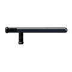 | 120.png | `https://raw.githubusercontent.com/WandzR/fac-item-icons/main/120.png` |
|  | absinto.png | `https://raw.githubusercontent.com/WandzR/fac-item-icons/main/absinto.png` |
|  | absolut.png | `https://raw.githubusercontent.com/WandzR/fac-item-icons/main/absolut.png` |
| 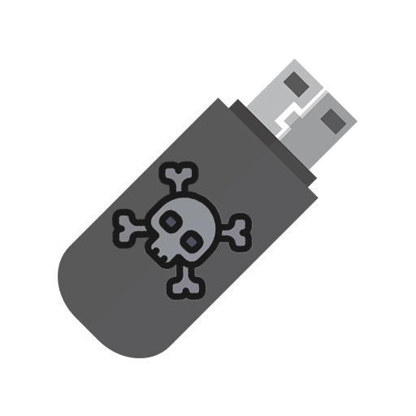 | acessodeepweb.png | `https://raw.githubusercontent.com/WandzR/fac-item-icons/main/acessodeepweb.png` |
|  | acetofenetidina.png | `https://raw.githubusercontent.com/WandzR/fac-item-icons/main/acetofenetidina.png` |
|  | acido-sulfurico.png | `https://raw.githubusercontent.com/WandzR/fac-item-icons/main/acido-sulfurico.png` |
|  | acidobateria.png | `https://raw.githubusercontent.com/WandzR/fac-item-icons/main/acidobateria.png` |
|  | acidolisergico.png | `https://raw.githubusercontent.com/WandzR/fac-item-icons/main/acidolisergico.png` |
|  | aco.png | `https://raw.githubusercontent.com/WandzR/fac-item-icons/main/aco.png` |
| 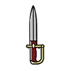 | adaga.png | `https://raw.githubusercontent.com/WandzR/fac-item-icons/main/adaga.png` |
|  | adrenaline.png | `https://raw.githubusercontent.com/WandzR/fac-item-icons/main/adrenaline.png` |
|  | adubo.png | `https://raw.githubusercontent.com/WandzR/fac-item-icons/main/adubo.png` |
| 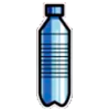 | agua.png | `https://raw.githubusercontent.com/WandzR/fac-item-icons/main/agua.png` |
| 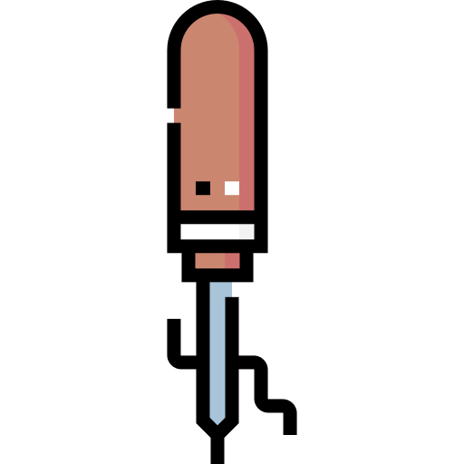 | agulha.png | `https://raw.githubusercontent.com/WandzR/fac-item-icons/main/agulha.png` |
| 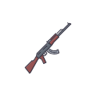 | ak103.png | `https://raw.githubusercontent.com/WandzR/fac-item-icons/main/ak103.png` |
| 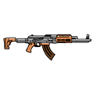 | ak47.png | `https://raw.githubusercontent.com/WandzR/fac-item-icons/main/ak47.png` |
| 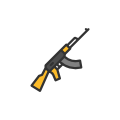 | ak74.png | `https://raw.githubusercontent.com/WandzR/fac-item-icons/main/ak74.png` |
| 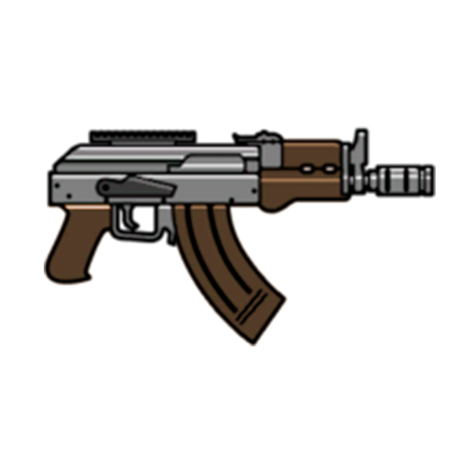 | akcompact.png | `https://raw.githubusercontent.com/WandzR/fac-item-icons/main/akcompact.png` |
|  | aks.png | `https://raw.githubusercontent.com/WandzR/fac-item-icons/main/aks.png` |
| 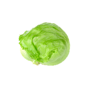 | alface.png | `https://raw.githubusercontent.com/WandzR/fac-item-icons/main/alface.png` |
|  | algema.png | `https://raw.githubusercontent.com/WandzR/fac-item-icons/main/algema.png` |
|  | algemas.png | `https://raw.githubusercontent.com/WandzR/fac-item-icons/main/algemas.png` |
|  | algodao.png | `https://raw.githubusercontent.com/WandzR/fac-item-icons/main/algodao.png` |
|  | alianca.png | `https://raw.githubusercontent.com/WandzR/fac-item-icons/main/alianca.png` |
|  | aluminio.png | `https://raw.githubusercontent.com/WandzR/fac-item-icons/main/aluminio.png` |
|  | alvejante.png | `https://raw.githubusercontent.com/WandzR/fac-item-icons/main/alvejante.png` |
| 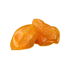 | ambar.png | `https://raw.githubusercontent.com/WandzR/fac-item-icons/main/ambar.png` |
|  | ametista.png | `https://raw.githubusercontent.com/WandzR/fac-item-icons/main/ametista.png` |
|  | ametista2.png | `https://raw.githubusercontent.com/WandzR/fac-item-icons/main/ametista2.png` |
|  | ammo.png | `https://raw.githubusercontent.com/WandzR/fac-item-icons/main/ammo.png` |
| 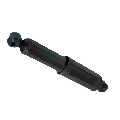 | amortecedor.png | `https://raw.githubusercontent.com/WandzR/fac-item-icons/main/amortecedor.png` |
| 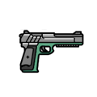 | amt.png | `https://raw.githubusercontent.com/WandzR/fac-item-icons/main/amt.png` |
| 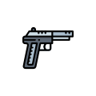 | amt380.png | `https://raw.githubusercontent.com/WandzR/fac-item-icons/main/amt380.png` |
|  | analdor.png | `https://raw.githubusercontent.com/WandzR/fac-item-icons/main/analdor.png` |
|  | analgesic.png | `https://raw.githubusercontent.com/WandzR/fac-item-icons/main/analgesic.png` |
| 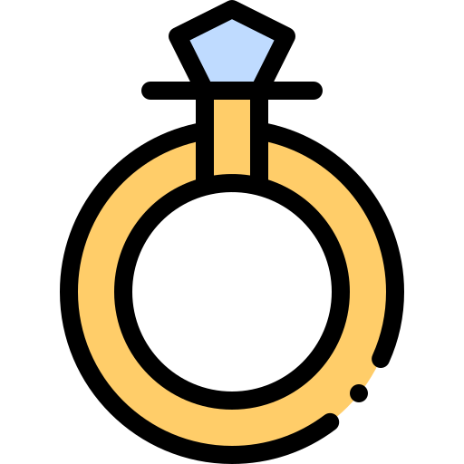 | aneldecompromisso.png | `https://raw.githubusercontent.com/WandzR/fac-item-icons/main/aneldecompromisso.png` |
|  | anelroubado.png | `https://raw.githubusercontent.com/WandzR/fac-item-icons/main/anelroubado.png` |
|  | anfetamina.png | `https://raw.githubusercontent.com/WandzR/fac-item-icons/main/anfetamina.png` |
| 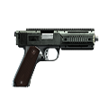 | appistol.png | `https://raw.githubusercontent.com/WandzR/fac-item-icons/main/appistol.png` |
| 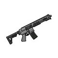 | ar15.png | `https://raw.githubusercontent.com/WandzR/fac-item-icons/main/ar15.png` |
|  | arame.png | `https://raw.githubusercontent.com/WandzR/fac-item-icons/main/arame.png` |
|  | armacaodeak.png | `https://raw.githubusercontent.com/WandzR/fac-item-icons/main/armacaodeak.png` |
|  | armacaodearma.png | `https://raw.githubusercontent.com/WandzR/fac-item-icons/main/armacaodearma.png` |
| 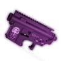 | armacaodeg3.png | `https://raw.githubusercontent.com/WandzR/fac-item-icons/main/armacaodeg3.png` |
| 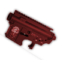 | armacaodemp5.png | `https://raw.githubusercontent.com/WandzR/fac-item-icons/main/armacaodemp5.png` |
| 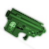 | armacaodetec.png | `https://raw.githubusercontent.com/WandzR/fac-item-icons/main/armacaodetec.png` |
|  | armselprotecta.png | `https://raw.githubusercontent.com/WandzR/fac-item-icons/main/armselprotecta.png` |
|  | asgco2.png | `https://raw.githubusercontent.com/WandzR/fac-item-icons/main/asgco2.png` |
| 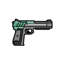 | ati.png | `https://raw.githubusercontent.com/WandzR/fac-item-icons/main/ati.png` |
|  | atifx45.png | `https://raw.githubusercontent.com/WandzR/fac-item-icons/main/atifx45.png` |
| 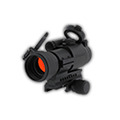 | attachs.png | `https://raw.githubusercontent.com/WandzR/fac-item-icons/main/attachs.png` |
|  | aulaitem.png | `https://raw.githubusercontent.com/WandzR/fac-item-icons/main/aulaitem.png` |
|  | aulaitem2.png | `https://raw.githubusercontent.com/WandzR/fac-item-icons/main/aulaitem2.png` |
|  | autorizacao.png | `https://raw.githubusercontent.com/WandzR/fac-item-icons/main/autorizacao.png` |
|  | awf.png | `https://raw.githubusercontent.com/WandzR/fac-item-icons/main/awf.png` |
| 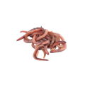 | bait.png | `https://raw.githubusercontent.com/WandzR/fac-item-icons/main/bait.png` |
|  | banco.png | `https://raw.githubusercontent.com/WandzR/fac-item-icons/main/banco.png` |
|  | bandage.png | `https://raw.githubusercontent.com/WandzR/fac-item-icons/main/bandage.png` |
|  | bandagem.png | `https://raw.githubusercontent.com/WandzR/fac-item-icons/main/bandagem.png` |
|  | barra-ferro.png | `https://raw.githubusercontent.com/WandzR/fac-item-icons/main/barra-ferro.png` |
|  | barra-ouro.png | `https://raw.githubusercontent.com/WandzR/fac-item-icons/main/barra-ouro.png` |
|  | barra-prata.png | `https://raw.githubusercontent.com/WandzR/fac-item-icons/main/barra-prata.png` |
|  | barracho.png | `https://raw.githubusercontent.com/WandzR/fac-item-icons/main/barracho.png` |
|  | barrametal.png | `https://raw.githubusercontent.com/WandzR/fac-item-icons/main/barrametal.png` |
|  | barrettm107.png | `https://raw.githubusercontent.com/WandzR/fac-item-icons/main/barrettm107.png` |
|  | baseado.png | `https://raw.githubusercontent.com/WandzR/fac-item-icons/main/baseado.png` |
|  | baseadosembolar.png | `https://raw.githubusercontent.com/WandzR/fac-item-icons/main/baseadosembolar.png` |
| 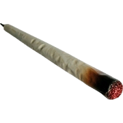 | basiado.png | `https://raw.githubusercontent.com/WandzR/fac-item-icons/main/basiado.png` |
|  | bat.png | `https://raw.githubusercontent.com/WandzR/fac-item-icons/main/bat.png` |
|  | batalha.png | `https://raw.githubusercontent.com/WandzR/fac-item-icons/main/batalha.png` |
|  | batata.png | `https://raw.githubusercontent.com/WandzR/fac-item-icons/main/batata.png` |
| 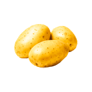 | batatacrua.png | `https://raw.githubusercontent.com/WandzR/fac-item-icons/main/batatacrua.png` |
|  | batataf.png | `https://raw.githubusercontent.com/WandzR/fac-item-icons/main/batataf.png` |
|  | batatinha.png | `https://raw.githubusercontent.com/WandzR/fac-item-icons/main/batatinha.png` |
|  | bateria.png | `https://raw.githubusercontent.com/WandzR/fac-item-icons/main/bateria.png` |
| 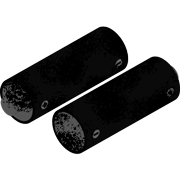 | bateria-queimado.png | `https://raw.githubusercontent.com/WandzR/fac-item-icons/main/bateria-queimado.png` |
|  | battleaxe.png | `https://raw.githubusercontent.com/WandzR/fac-item-icons/main/battleaxe.png` |
|  | bauaberto.png | `https://raw.githubusercontent.com/WandzR/fac-item-icons/main/bauaberto.png` |
|  | baufechado.png | `https://raw.githubusercontent.com/WandzR/fac-item-icons/main/baufechado.png` |
|  | bcereal.png | `https://raw.githubusercontent.com/WandzR/fac-item-icons/main/bcereal.png` |
|  | bchocolate.png | `https://raw.githubusercontent.com/WandzR/fac-item-icons/main/bchocolate.png` |
| 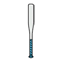 | beisebol.png | `https://raw.githubusercontent.com/WandzR/fac-item-icons/main/beisebol.png` |
| 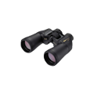 | binoculars.png | `https://raw.githubusercontent.com/WandzR/fac-item-icons/main/binoculars.png` |
|  | binoculos.png | `https://raw.githubusercontent.com/WandzR/fac-item-icons/main/binoculos.png` |
|  | blackcard.png | `https://raw.githubusercontent.com/WandzR/fac-item-icons/main/blackcard.png` |
| 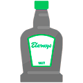 | blarneys.png | `https://raw.githubusercontent.com/WandzR/fac-item-icons/main/blarneys.png` |
|  | bleuterd.png | `https://raw.githubusercontent.com/WandzR/fac-item-icons/main/bleuterd.png` |
| 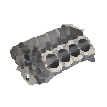 | blocodomotor.png | `https://raw.githubusercontent.com/WandzR/fac-item-icons/main/blocodomotor.png` |
|  | blueberry.png | `https://raw.githubusercontent.com/WandzR/fac-item-icons/main/blueberry.png` |
|  | bluecard.png | `https://raw.githubusercontent.com/WandzR/fac-item-icons/main/bluecard.png` |
|  | bolabaseball.png | `https://raw.githubusercontent.com/WandzR/fac-item-icons/main/bolabaseball.png` |
|  | bolaneve.png | `https://raw.githubusercontent.com/WandzR/fac-item-icons/main/bolaneve.png` |
|  | bolo.png | `https://raw.githubusercontent.com/WandzR/fac-item-icons/main/bolo.png` |
| 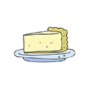 | boloqueijo.png | `https://raw.githubusercontent.com/WandzR/fac-item-icons/main/boloqueijo.png` |
| 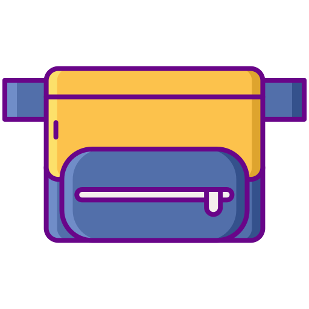 | bolso.png | `https://raw.githubusercontent.com/WandzR/fac-item-icons/main/bolso.png` |
|  | bomb.png | `https://raw.githubusercontent.com/WandzR/fac-item-icons/main/bomb.png` |
|  | bombacano.png | `https://raw.githubusercontent.com/WandzR/fac-item-icons/main/bombacano.png` |
| 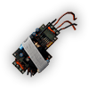 | bombacaseira.png | `https://raw.githubusercontent.com/WandzR/fac-item-icons/main/bombacaseira.png` |
|  | borracha.png | `https://raw.githubusercontent.com/WandzR/fac-item-icons/main/borracha.png` |
|  | bourgeoix.png | `https://raw.githubusercontent.com/WandzR/fac-item-icons/main/bourgeoix.png` |
| 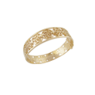 | bracelet.png | `https://raw.githubusercontent.com/WandzR/fac-item-icons/main/bracelet.png` |
| 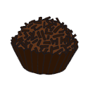 | brigadeiro.png | `https://raw.githubusercontent.com/WandzR/fac-item-icons/main/brigadeiro.png` |
|  | brincoroubado.png | `https://raw.githubusercontent.com/WandzR/fac-item-icons/main/brincoroubado.png` |
|  | bronze.png | `https://raw.githubusercontent.com/WandzR/fac-item-icons/main/bronze.png` |
|  | bronze2.png | `https://raw.githubusercontent.com/WandzR/fac-item-icons/main/bronze2.png` |
| 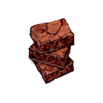 | brownie.png | `https://raw.githubusercontent.com/WandzR/fac-item-icons/main/brownie.png` |
| 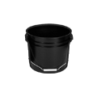 | bucket.png | `https://raw.githubusercontent.com/WandzR/fac-item-icons/main/bucket.png` |
|  | bullpuprifle.png | `https://raw.githubusercontent.com/WandzR/fac-item-icons/main/bullpuprifle.png` |
|  | bullpuprifle_mk2.png | `https://raw.githubusercontent.com/WandzR/fac-item-icons/main/bullpuprifle-mk2.png` |
|  | buque.png | `https://raw.githubusercontent.com/WandzR/fac-item-icons/main/buque.png` |
|  | buscopau.png | `https://raw.githubusercontent.com/WandzR/fac-item-icons/main/buscopau.png` |
|  | buscopom.png | `https://raw.githubusercontent.com/WandzR/fac-item-icons/main/buscopom.png` |
|  | c4.png | `https://raw.githubusercontent.com/WandzR/fac-item-icons/main/c4.png` |
|  | cabra.png | `https://raw.githubusercontent.com/WandzR/fac-item-icons/main/cabra.png` |
|  | cafe.png | `https://raw.githubusercontent.com/WandzR/fac-item-icons/main/cafe.png` |
|  | cafecleite.png | `https://raw.githubusercontent.com/WandzR/fac-item-icons/main/cafecleite.png` |
|  | cafeexpresso.png | `https://raw.githubusercontent.com/WandzR/fac-item-icons/main/cafeexpresso.png` |
|  | cafeina.png | `https://raw.githubusercontent.com/WandzR/fac-item-icons/main/cafeina.png` |
| 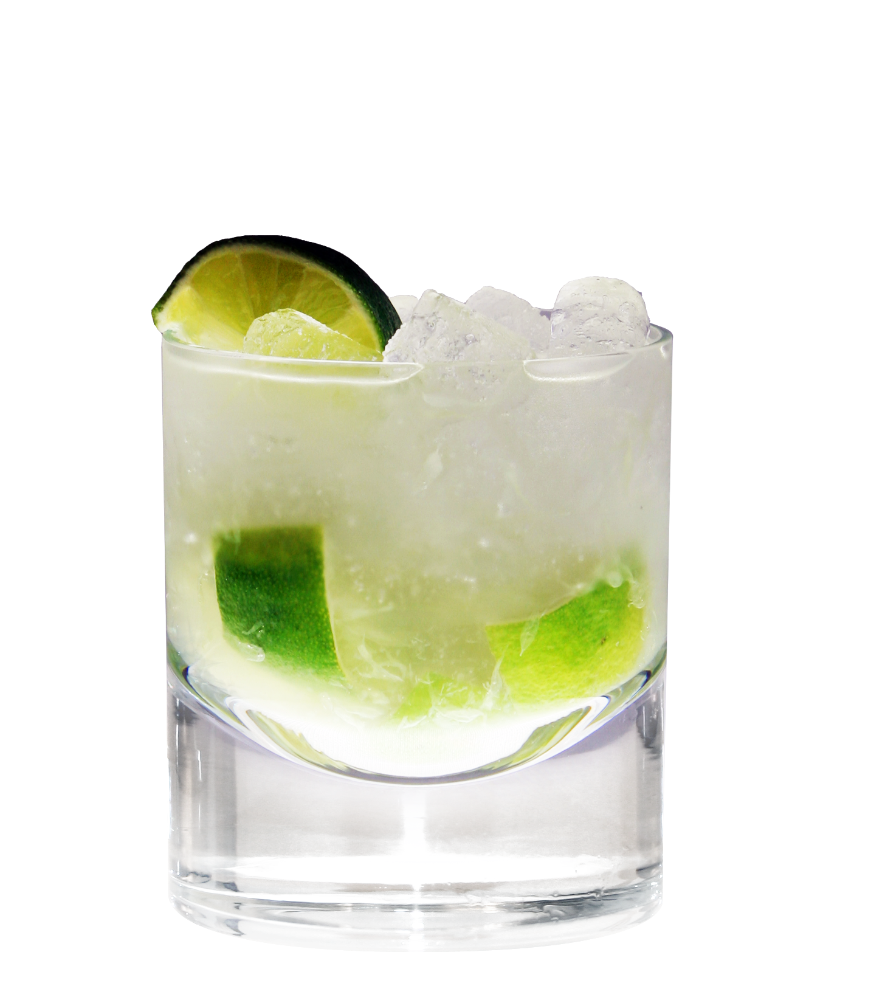 | caipirinha.png | `https://raw.githubusercontent.com/WandzR/fac-item-icons/main/caipirinha.png` |
| 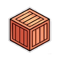 | caixa.png | `https://raw.githubusercontent.com/WandzR/fac-item-icons/main/caixa.png` |
|  | caixa-vazia.png | `https://raw.githubusercontent.com/WandzR/fac-item-icons/main/caixa-vazia.png` |
| 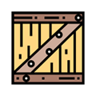 | caixademadeira.png | `https://raw.githubusercontent.com/WandzR/fac-item-icons/main/caixademadeira.png` |
|  | caixadepizza.png | `https://raw.githubusercontent.com/WandzR/fac-item-icons/main/caixadepizza.png` |
| 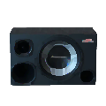 | caixadesom.png | `https://raw.githubusercontent.com/WandzR/fac-item-icons/main/caixadesom.png` |
| 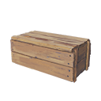 | caixadeuva.png | `https://raw.githubusercontent.com/WandzR/fac-item-icons/main/caixadeuva.png` |
| 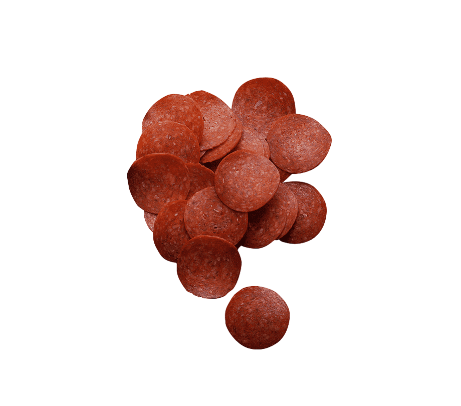 | calabresa.png | `https://raw.githubusercontent.com/WandzR/fac-item-icons/main/calabresa.png` |
|  | calabresacrua.png | `https://raw.githubusercontent.com/WandzR/fac-item-icons/main/calabresacrua.png` |
|  | calcio-po.png | `https://raw.githubusercontent.com/WandzR/fac-item-icons/main/calcio-po.png` |
|  | calculadora.png | `https://raw.githubusercontent.com/WandzR/fac-item-icons/main/calculadora.png` |
| 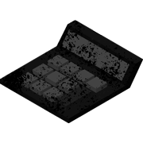 | calculadora-queimado.png | `https://raw.githubusercontent.com/WandzR/fac-item-icons/main/calculadora-queimado.png` |
|  | caldo.png | `https://raw.githubusercontent.com/WandzR/fac-item-icons/main/caldo.png` |
|  | cambio.png | `https://raw.githubusercontent.com/WandzR/fac-item-icons/main/cambio.png` |
| 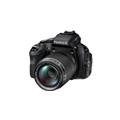 | camera.png | `https://raw.githubusercontent.com/WandzR/fac-item-icons/main/camera.png` |
|  | camisinha.png | `https://raw.githubusercontent.com/WandzR/fac-item-icons/main/camisinha.png` |
| 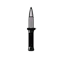 | canivete.png | `https://raw.githubusercontent.com/WandzR/fac-item-icons/main/canivete.png` |
|  | capsula.png | `https://raw.githubusercontent.com/WandzR/fac-item-icons/main/capsula.png` |
| 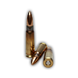 | capsula762.png | `https://raw.githubusercontent.com/WandzR/fac-item-icons/main/capsula762.png` |
| 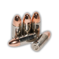 | capsula9mm.png | `https://raw.githubusercontent.com/WandzR/fac-item-icons/main/capsula9mm.png` |
|  | capsulaa.png | `https://raw.githubusercontent.com/WandzR/fac-item-icons/main/capsulaa.png` |
|  | capsulas.png | `https://raw.githubusercontent.com/WandzR/fac-item-icons/main/capsulas.png` |
|  | capuccino.png | `https://raw.githubusercontent.com/WandzR/fac-item-icons/main/capuccino.png` |
|  | capuz.png | `https://raw.githubusercontent.com/WandzR/fac-item-icons/main/capuz.png` |
|  | carbono.png | `https://raw.githubusercontent.com/WandzR/fac-item-icons/main/carbono.png` |
|  | card.png | `https://raw.githubusercontent.com/WandzR/fac-item-icons/main/card.png` |
|  | carne.png | `https://raw.githubusercontent.com/WandzR/fac-item-icons/main/carne.png` |
| 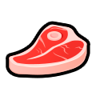 | carnecrua.png | `https://raw.githubusercontent.com/WandzR/fac-item-icons/main/carnecrua.png` |
|  | carnedeaguia.png | `https://raw.githubusercontent.com/WandzR/fac-item-icons/main/carnedeaguia.png` |
|  | carnedecervo.png | `https://raw.githubusercontent.com/WandzR/fac-item-icons/main/carnedecervo.png` |
|  | carnedecoelho.png | `https://raw.githubusercontent.com/WandzR/fac-item-icons/main/carnedecoelho.png` |
|  | carnedecormorao.png | `https://raw.githubusercontent.com/WandzR/fac-item-icons/main/carnedecormorao.png` |
|  | carnedecorvo.png | `https://raw.githubusercontent.com/WandzR/fac-item-icons/main/carnedecorvo.png` |
|  | carnedecoyote.png | `https://raw.githubusercontent.com/WandzR/fac-item-icons/main/carnedecoyote.png` |
|  | carnedejavali.png | `https://raw.githubusercontent.com/WandzR/fac-item-icons/main/carnedejavali.png` |
|  | carnedelobo.png | `https://raw.githubusercontent.com/WandzR/fac-item-icons/main/carnedelobo.png` |
|  | carnedepuma.png | `https://raw.githubusercontent.com/WandzR/fac-item-icons/main/carnedepuma.png` |
| 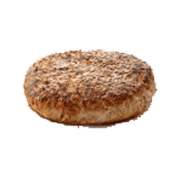 | carnehamburguer.png | `https://raw.githubusercontent.com/WandzR/fac-item-icons/main/carnehamburguer.png` |
|  | carp.png | `https://raw.githubusercontent.com/WandzR/fac-item-icons/main/carp.png` |
|  | carrafa.png | `https://raw.githubusercontent.com/WandzR/fac-item-icons/main/carrafa.png` |
|  | carregadordesmg.png | `https://raw.githubusercontent.com/WandzR/fac-item-icons/main/carregadordesmg.png` |
|  | carregadorroubado.png | `https://raw.githubusercontent.com/WandzR/fac-item-icons/main/carregadorroubado.png` |
|  | cartao-debito.png | `https://raw.githubusercontent.com/WandzR/fac-item-icons/main/cartao-debito.png` |
|  | cartaoclonado.png | `https://raw.githubusercontent.com/WandzR/fac-item-icons/main/cartaoclonado.png` |
|  | cartaodecredito.png | `https://raw.githubusercontent.com/WandzR/fac-item-icons/main/cartaodecredito.png` |
|  | cartaodesmanche.png | `https://raw.githubusercontent.com/WandzR/fac-item-icons/main/cartaodesmanche.png` |
|  | carteira.png | `https://raw.githubusercontent.com/WandzR/fac-item-icons/main/carteira.png` |
|  | carteiraroubada.png | `https://raw.githubusercontent.com/WandzR/fac-item-icons/main/carteiraroubada.png` |
|  | cash.png | `https://raw.githubusercontent.com/WandzR/fac-item-icons/main/cash.png` |
|  | cassetete.png | `https://raw.githubusercontent.com/WandzR/fac-item-icons/main/cassetete.png` |
|  | cativa.png | `https://raw.githubusercontent.com/WandzR/fac-item-icons/main/cativa.png` |
|  | catuaba.png | `https://raw.githubusercontent.com/WandzR/fac-item-icons/main/catuaba.png` |
|  | cellphone.png | `https://raw.githubusercontent.com/WandzR/fac-item-icons/main/cellphone.png` |
|  | celular.png | `https://raw.githubusercontent.com/WandzR/fac-item-icons/main/celular.png` |
|  | celular-pro.png | `https://raw.githubusercontent.com/WandzR/fac-item-icons/main/celular-pro.png` |
|  | celular-queimado.png | `https://raw.githubusercontent.com/WandzR/fac-item-icons/main/celular-queimado.png` |
|  | cerejas.png | `https://raw.githubusercontent.com/WandzR/fac-item-icons/main/cerejas.png` |
|  | cerveja.png | `https://raw.githubusercontent.com/WandzR/fac-item-icons/main/cerveja.png` |
|  | cha.png | `https://raw.githubusercontent.com/WandzR/fac-item-icons/main/cha.png` |
|  | chandon.png | `https://raw.githubusercontent.com/WandzR/fac-item-icons/main/chandon.png` |
|  | chapeu.png | `https://raw.githubusercontent.com/WandzR/fac-item-icons/main/chapeu.png` |
|  | cherenkov.png | `https://raw.githubusercontent.com/WandzR/fac-item-icons/main/cherenkov.png` |
|  | chip.png | `https://raw.githubusercontent.com/WandzR/fac-item-icons/main/chip.png` |
|  | chip2.png | `https://raw.githubusercontent.com/WandzR/fac-item-icons/main/chip2.png` |
|  | chips.png | `https://raw.githubusercontent.com/WandzR/fac-item-icons/main/chips.png` |
|  | chips_casino.png | `https://raw.githubusercontent.com/WandzR/fac-item-icons/main/chips-casino.png` |
|  | chocolate.png | `https://raw.githubusercontent.com/WandzR/fac-item-icons/main/chocolate.png` |
|  | chumbo.png | `https://raw.githubusercontent.com/WandzR/fac-item-icons/main/chumbo.png` |
|  | cicatricure.png | `https://raw.githubusercontent.com/WandzR/fac-item-icons/main/cicatricure.png` |
|  | cigarette.png | `https://raw.githubusercontent.com/WandzR/fac-item-icons/main/cigarette.png` |
|  | cigarrob.png | `https://raw.githubusercontent.com/WandzR/fac-item-icons/main/cigarrob.png` |
|  | cigarrok.png | `https://raw.githubusercontent.com/WandzR/fac-item-icons/main/cigarrok.png` |
|  | cigarromaconha.png | `https://raw.githubusercontent.com/WandzR/fac-item-icons/main/cigarromaconha.png` |
|  | cloridratodeecgonina.png | `https://raw.githubusercontent.com/WandzR/fac-item-icons/main/cloridratodeecgonina.png` |
|  | cloroformio.png | `https://raw.githubusercontent.com/WandzR/fac-item-icons/main/cloroformio.png` |
|  | clothescoin.png | `https://raw.githubusercontent.com/WandzR/fac-item-icons/main/clothescoin.png` |
|  | cmpak103.png | `https://raw.githubusercontent.com/WandzR/fac-item-icons/main/cmpak103.png` |
|  | cmpfive.png | `https://raw.githubusercontent.com/WandzR/fac-item-icons/main/cmpfive.png` |
|  | cmphkp7m10.png | `https://raw.githubusercontent.com/WandzR/fac-item-icons/main/cmphkp7m10.png` |
|  | cmpmak103.png | `https://raw.githubusercontent.com/WandzR/fac-item-icons/main/cmpmak103.png` |
|  | cmpmfive.png | `https://raw.githubusercontent.com/WandzR/fac-item-icons/main/cmpmfive.png` |
|  | cmpmhkp7m10.png | `https://raw.githubusercontent.com/WandzR/fac-item-icons/main/cmpmhkp7m10.png` |
|  | cmpmmtar21.png | `https://raw.githubusercontent.com/WandzR/fac-item-icons/main/cmpmmtar21.png` |
|  | cmpmtar21.png | `https://raw.githubusercontent.com/WandzR/fac-item-icons/main/cmpmtar21.png` |
|  | cnh.png | `https://raw.githubusercontent.com/WandzR/fac-item-icons/main/cnh.png` |
|  | cnh_a.png | `https://raw.githubusercontent.com/WandzR/fac-item-icons/main/cnh-a.png` |
|  | cnh_b.png | `https://raw.githubusercontent.com/WandzR/fac-item-icons/main/cnh-b.png` |
|  | cnh_c.png | `https://raw.githubusercontent.com/WandzR/fac-item-icons/main/cnh-c.png` |
|  | cnh_d.png | `https://raw.githubusercontent.com/WandzR/fac-item-icons/main/cnh-d.png` |
|  | cobre.png | `https://raw.githubusercontent.com/WandzR/fac-item-icons/main/cobre.png` |
|  | coca.png | `https://raw.githubusercontent.com/WandzR/fac-item-icons/main/coca.png` |
|  | coca-alta.png | `https://raw.githubusercontent.com/WandzR/fac-item-icons/main/coca-alta.png` |
|  | coca-baixa.png | `https://raw.githubusercontent.com/WandzR/fac-item-icons/main/coca-baixa.png` |
|  | coca-media.png | `https://raw.githubusercontent.com/WandzR/fac-item-icons/main/coca-media.png` |
|  | cocacola.png | `https://raw.githubusercontent.com/WandzR/fac-item-icons/main/cocacola.png` |
|  | cocaina.png | `https://raw.githubusercontent.com/WandzR/fac-item-icons/main/cocaina.png` |
|  | cocamisturada.png | `https://raw.githubusercontent.com/WandzR/fac-item-icons/main/cocamisturada.png` |
|  | coco.png | `https://raw.githubusercontent.com/WandzR/fac-item-icons/main/coco.png` |
|  | coffe.png | `https://raw.githubusercontent.com/WandzR/fac-item-icons/main/coffe.png` |
|  | coffee.png | `https://raw.githubusercontent.com/WandzR/fac-item-icons/main/coffee.png` |
|  | cola.png | `https://raw.githubusercontent.com/WandzR/fac-item-icons/main/cola.png` |
|  | colardeperolas.png | `https://raw.githubusercontent.com/WandzR/fac-item-icons/main/colardeperolas.png` |
|  | colarroubado.png | `https://raw.githubusercontent.com/WandzR/fac-item-icons/main/colarroubado.png` |
|  | colete.png | `https://raw.githubusercontent.com/WandzR/fac-item-icons/main/colete.png` |
|  | colt1851.png | `https://raw.githubusercontent.com/WandzR/fac-item-icons/main/colt1851.png` |
|  | combustivel.png | `https://raw.githubusercontent.com/WandzR/fac-item-icons/main/combustivel.png` |
|  | compactlauncher.png | `https://raw.githubusercontent.com/WandzR/fac-item-icons/main/compactlauncher.png` |
|  | compattach.png | `https://raw.githubusercontent.com/WandzR/fac-item-icons/main/compattach.png` |
|  | compferramenta.png | `https://raw.githubusercontent.com/WandzR/fac-item-icons/main/compferramenta.png` |
|  | complanca.png | `https://raw.githubusercontent.com/WandzR/fac-item-icons/main/complanca.png` |
|  | complsd.png | `https://raw.githubusercontent.com/WandzR/fac-item-icons/main/complsd.png` |
|  | composito-alta.png | `https://raw.githubusercontent.com/WandzR/fac-item-icons/main/composito-alta.png` |
|  | composito-baixa.png | `https://raw.githubusercontent.com/WandzR/fac-item-icons/main/composito-baixa.png` |
|  | composito-media.png | `https://raw.githubusercontent.com/WandzR/fac-item-icons/main/composito-media.png` |
|  | compost.png | `https://raw.githubusercontent.com/WandzR/fac-item-icons/main/compost.png` |
|  | compostoquimico.png | `https://raw.githubusercontent.com/WandzR/fac-item-icons/main/compostoquimico.png` |
|  | conhaque.png | `https://raw.githubusercontent.com/WandzR/fac-item-icons/main/conhaque.png` |
|  | controle.png | `https://raw.githubusercontent.com/WandzR/fac-item-icons/main/controle.png` |
|  | controle-queimado.png | `https://raw.githubusercontent.com/WandzR/fac-item-icons/main/controle-queimado.png` |
|  | cookie.png | `https://raw.githubusercontent.com/WandzR/fac-item-icons/main/cookie.png` |
|  | copper.png | `https://raw.githubusercontent.com/WandzR/fac-item-icons/main/copper.png` |
|  | coquetel.png | `https://raw.githubusercontent.com/WandzR/fac-item-icons/main/coquetel.png` |
|  | coquetelmolotov.png | `https://raw.githubusercontent.com/WandzR/fac-item-icons/main/coquetelmolotov.png` |
|  | corda.png | `https://raw.githubusercontent.com/WandzR/fac-item-icons/main/corda.png` |
|  | cordas.png | `https://raw.githubusercontent.com/WandzR/fac-item-icons/main/cordas.png` |
|  | cormorantmeat.png | `https://raw.githubusercontent.com/WandzR/fac-item-icons/main/cormorantmeat.png` |
|  | corote.png | `https://raw.githubusercontent.com/WandzR/fac-item-icons/main/corote.png` |
|  | corpo-ak47.png | `https://raw.githubusercontent.com/WandzR/fac-item-icons/main/corpo-ak47.png` |
|  | corpo-aks.png | `https://raw.githubusercontent.com/WandzR/fac-item-icons/main/corpo-aks.png` |
|  | corpo-deserteagle.png | `https://raw.githubusercontent.com/WandzR/fac-item-icons/main/corpo-deserteagle.png` |
|  | corpo-fiveseven.png | `https://raw.githubusercontent.com/WandzR/fac-item-icons/main/corpo-fiveseven.png` |
|  | corpo-fuzil.png | `https://raw.githubusercontent.com/WandzR/fac-item-icons/main/corpo-fuzil.png` |
|  | corpo-glock.png | `https://raw.githubusercontent.com/WandzR/fac-item-icons/main/corpo-glock.png` |
|  | corpo-m4a1.png | `https://raw.githubusercontent.com/WandzR/fac-item-icons/main/corpo-m4a1.png` |
|  | corpo-magnum44.png | `https://raw.githubusercontent.com/WandzR/fac-item-icons/main/corpo-magnum44.png` |
|  | corpo-pistola.png | `https://raw.githubusercontent.com/WandzR/fac-item-icons/main/corpo-pistola.png` |
|  | corpo-remington.png | `https://raw.githubusercontent.com/WandzR/fac-item-icons/main/corpo-remington.png` |
|  | corpo-smg.png | `https://raw.githubusercontent.com/WandzR/fac-item-icons/main/corpo-smg.png` |
|  | corpo-sub.png | `https://raw.githubusercontent.com/WandzR/fac-item-icons/main/corpo-sub.png` |
|  | corpo-uzi.png | `https://raw.githubusercontent.com/WandzR/fac-item-icons/main/corpo-uzi.png` |
|  | correia.png | `https://raw.githubusercontent.com/WandzR/fac-item-icons/main/correia.png` |
|  | corvina.png | `https://raw.githubusercontent.com/WandzR/fac-item-icons/main/corvina.png` |
|  | cougarmeat.png | `https://raw.githubusercontent.com/WandzR/fac-item-icons/main/cougarmeat.png` |
|  | coumadin.png | `https://raw.githubusercontent.com/WandzR/fac-item-icons/main/coumadin.png` |
|  | couro.png | `https://raw.githubusercontent.com/WandzR/fac-item-icons/main/couro.png` |
|  | coyotemeat.png | `https://raw.githubusercontent.com/WandzR/fac-item-icons/main/coyotemeat.png` |
|  | credential.png | `https://raw.githubusercontent.com/WandzR/fac-item-icons/main/credential.png` |
|  | crowbar.png | `https://raw.githubusercontent.com/WandzR/fac-item-icons/main/crowbar.png` |
|  | crowmeat.png | `https://raw.githubusercontent.com/WandzR/fac-item-icons/main/crowmeat.png` |
|  | csativa.png | `https://raw.githubusercontent.com/WandzR/fac-item-icons/main/csativa.png` |
|  | cubodemaconha.png | `https://raw.githubusercontent.com/WandzR/fac-item-icons/main/cubodemaconha.png` |
|  | czp09.png | `https://raw.githubusercontent.com/WandzR/fac-item-icons/main/czp09.png` |
|  | dagger.png | `https://raw.githubusercontent.com/WandzR/fac-item-icons/main/dagger.png` |
|  | deagle.png | `https://raw.githubusercontent.com/WandzR/fac-item-icons/main/deagle.png` |
|  | decupramim.png | `https://raw.githubusercontent.com/WandzR/fac-item-icons/main/decupramim.png` |
|  | deermeat.png | `https://raw.githubusercontent.com/WandzR/fac-item-icons/main/deermeat.png` |
|  | delivery.png | `https://raw.githubusercontent.com/WandzR/fac-item-icons/main/delivery.png` |
|  | derserteagle.png | `https://raw.githubusercontent.com/WandzR/fac-item-icons/main/derserteagle.png` |
|  | desert.png | `https://raw.githubusercontent.com/WandzR/fac-item-icons/main/desert.png` |
|  | desertammo.png | `https://raw.githubusercontent.com/WandzR/fac-item-icons/main/desertammo.png` |
|  | deserteagle.png | `https://raw.githubusercontent.com/WandzR/fac-item-icons/main/deserteagle.png` |
|  | detonador.png | `https://raw.githubusercontent.com/WandzR/fac-item-icons/main/detonador.png` |
|  | dewars.png | `https://raw.githubusercontent.com/WandzR/fac-item-icons/main/dewars.png` |
|  | dia_box.png | `https://raw.githubusercontent.com/WandzR/fac-item-icons/main/dia-box.png` |
|  | diamante.png | `https://raw.githubusercontent.com/WandzR/fac-item-icons/main/diamante.png` |
|  | diamante2.png | `https://raw.githubusercontent.com/WandzR/fac-item-icons/main/diamante2.png` |
|  | dietilamina.png | `https://raw.githubusercontent.com/WandzR/fac-item-icons/main/dietilamina.png` |
|  | dildo.png | `https://raw.githubusercontent.com/WandzR/fac-item-icons/main/dildo.png` |
|  | dinheiro.png | `https://raw.githubusercontent.com/WandzR/fac-item-icons/main/dinheiro.png` |
|  | dinheiro-sujo.png | `https://raw.githubusercontent.com/WandzR/fac-item-icons/main/dinheiro-sujo.png` |
|  | dinheiroempacotado.png | `https://raw.githubusercontent.com/WandzR/fac-item-icons/main/dinheiroempacotado.png` |
|  | dinheirolimpo.png | `https://raw.githubusercontent.com/WandzR/fac-item-icons/main/dinheirolimpo.png` |
|  | dinheiromolhado.png | `https://raw.githubusercontent.com/WandzR/fac-item-icons/main/dinheiromolhado.png` |
|  | dinheirosujo.png | `https://raw.githubusercontent.com/WandzR/fac-item-icons/main/dinheirosujo.png` |
|  | dinheirosujo1.png | `https://raw.githubusercontent.com/WandzR/fac-item-icons/main/dinheirosujo1.png` |
|  | dipiroca.png | `https://raw.githubusercontent.com/WandzR/fac-item-icons/main/dipiroca.png` |
|  | Dipirona.png | `https://raw.githubusercontent.com/WandzR/fac-item-icons/main/dipirona.png` |
|  | dirtydollars.png | `https://raw.githubusercontent.com/WandzR/fac-item-icons/main/dirtydollars.png` |
|  | dirtywater.png | `https://raw.githubusercontent.com/WandzR/fac-item-icons/main/dirtywater.png` |
|  | divingsuit.png | `https://raw.githubusercontent.com/WandzR/fac-item-icons/main/divingsuit.png` |
|  | dollars.png | `https://raw.githubusercontent.com/WandzR/fac-item-icons/main/dollars.png` |
|  | dollars2.png | `https://raw.githubusercontent.com/WandzR/fac-item-icons/main/dollars2.png` |
|  | donut.png | `https://raw.githubusercontent.com/WandzR/fac-item-icons/main/donut.png` |
|  | dorflex.png | `https://raw.githubusercontent.com/WandzR/fac-item-icons/main/dorflex.png` |
|  | dorfrex.png | `https://raw.githubusercontent.com/WandzR/fac-item-icons/main/dorfrex.png` |
|  | doubleaction.png | `https://raw.githubusercontent.com/WandzR/fac-item-icons/main/doubleaction.png` |
|  | doublem.png | `https://raw.githubusercontent.com/WandzR/fac-item-icons/main/doublem.png` |
|  | dourado.png | `https://raw.githubusercontent.com/WandzR/fac-item-icons/main/dourado.png` |
|  | dropar.png | `https://raw.githubusercontent.com/WandzR/fac-item-icons/main/dropar.png` |
|  | eaglemeat.png | `https://raw.githubusercontent.com/WandzR/fac-item-icons/main/eaglemeat.png` |
|  | ecstasy.png | `https://raw.githubusercontent.com/WandzR/fac-item-icons/main/ecstasy.png` |
|  | eletronics.png | `https://raw.githubusercontent.com/WandzR/fac-item-icons/main/eletronics.png` |
|  | embalagemplastica.png | `https://raw.githubusercontent.com/WandzR/fac-item-icons/main/embalagemplastica.png` |
|  | embreagem.png | `https://raw.githubusercontent.com/WandzR/fac-item-icons/main/embreagem.png` |
|  | emptybottle.png | `https://raw.githubusercontent.com/WandzR/fac-item-icons/main/emptybottle.png` |
|  | encomenda.png | `https://raw.githubusercontent.com/WandzR/fac-item-icons/main/encomenda.png` |
|  | energetico.png | `https://raw.githubusercontent.com/WandzR/fac-item-icons/main/energetico.png` |
|  | energetico2.png | `https://raw.githubusercontent.com/WandzR/fac-item-icons/main/energetico2.png` |
|  | enviar.png | `https://raw.githubusercontent.com/WandzR/fac-item-icons/main/enviar.png` |
|  | escapamento.png | `https://raw.githubusercontent.com/WandzR/fac-item-icons/main/escapamento.png` |
|  | esmeralda.png | `https://raw.githubusercontent.com/WandzR/fac-item-icons/main/esmeralda.png` |
|  | esmeralda2.png | `https://raw.githubusercontent.com/WandzR/fac-item-icons/main/esmeralda2.png` |
|  | estepe.png | `https://raw.githubusercontent.com/WandzR/fac-item-icons/main/estepe.png` |
|  | eter.png | `https://raw.githubusercontent.com/WandzR/fac-item-icons/main/eter.png` |
|  | eterecloroformio.png | `https://raw.githubusercontent.com/WandzR/fac-item-icons/main/eterecloroformio.png` |
|  | etiqueta.png | `https://raw.githubusercontent.com/WandzR/fac-item-icons/main/etiqueta.png` |
|  | extinguisher.png | `https://raw.githubusercontent.com/WandzR/fac-item-icons/main/extinguisher.png` |
|  | extintor.png | `https://raw.githubusercontent.com/WandzR/fac-item-icons/main/extintor.png` |
|  | faca.png | `https://raw.githubusercontent.com/WandzR/fac-item-icons/main/faca.png` |
|  | Fajuta.png | `https://raw.githubusercontent.com/WandzR/fac-item-icons/main/fajuta.png` |
|  | famasf1.png | `https://raw.githubusercontent.com/WandzR/fac-item-icons/main/famasf1.png` |
|  | fardamentopm.png | `https://raw.githubusercontent.com/WandzR/fac-item-icons/main/fardamentopm.png` |
|  | fardastaff1.png | `https://raw.githubusercontent.com/WandzR/fac-item-icons/main/fardastaff1.png` |
|  | farol.png | `https://raw.githubusercontent.com/WandzR/fac-item-icons/main/farol.png` |
|  | fartificio.png | `https://raw.githubusercontent.com/WandzR/fac-item-icons/main/fartificio.png` |
|  | fatiapao.png | `https://raw.githubusercontent.com/WandzR/fac-item-icons/main/fatiapao.png` |
|  | ferramenta.png | `https://raw.githubusercontent.com/WandzR/fac-item-icons/main/ferramenta.png` |
|  | ferramentas.png | `https://raw.githubusercontent.com/WandzR/fac-item-icons/main/ferramentas.png` |
|  | ferro.png | `https://raw.githubusercontent.com/WandzR/fac-item-icons/main/ferro.png` |
|  | ferro2.png | `https://raw.githubusercontent.com/WandzR/fac-item-icons/main/ferro2.png` |
|  | fertilizante.png | `https://raw.githubusercontent.com/WandzR/fac-item-icons/main/fertilizante.png` |
|  | ficha.png | `https://raw.githubusercontent.com/WandzR/fac-item-icons/main/ficha.png` |
|  | fio.png | `https://raw.githubusercontent.com/WandzR/fac-item-icons/main/fio.png` |
|  | fioeletronico.png | `https://raw.githubusercontent.com/WandzR/fac-item-icons/main/fioeletronico.png` |
|  | firecracker.png | `https://raw.githubusercontent.com/WandzR/fac-item-icons/main/firecracker.png` |
|  | firework.png | `https://raw.githubusercontent.com/WandzR/fac-item-icons/main/firework.png` |
|  | fishingrod.png | `https://raw.githubusercontent.com/WandzR/fac-item-icons/main/fishingrod.png` |
|  | five.png | `https://raw.githubusercontent.com/WandzR/fac-item-icons/main/five.png` |
|  | fiveseven.png | `https://raw.githubusercontent.com/WandzR/fac-item-icons/main/fiveseven.png` |
|  | flare.png | `https://raw.githubusercontent.com/WandzR/fac-item-icons/main/flare.png` |
|  | flashlight.png | `https://raw.githubusercontent.com/WandzR/fac-item-icons/main/flashlight.png` |
|  | flores.png | `https://raw.githubusercontent.com/WandzR/fac-item-icons/main/flores.png` |
|  | fn1903.png | `https://raw.githubusercontent.com/WandzR/fac-item-icons/main/fn1903.png` |
|  | folha-marijuana.png | `https://raw.githubusercontent.com/WandzR/fac-item-icons/main/folha-marijuana.png` |
|  | folhadecoca.png | `https://raw.githubusercontent.com/WandzR/fac-item-icons/main/folhadecoca.png` |
|  | folhademaconha.png | `https://raw.githubusercontent.com/WandzR/fac-item-icons/main/folhademaconha.png` |
|  | folhas-coca.png | `https://raw.githubusercontent.com/WandzR/fac-item-icons/main/folhas-coca.png` |
|  | folhinha.png | `https://raw.githubusercontent.com/WandzR/fac-item-icons/main/folhinha.png` |
|  | frango.png | `https://raw.githubusercontent.com/WandzR/fac-item-icons/main/frango.png` |
|  | frappuccino.png | `https://raw.githubusercontent.com/WandzR/fac-item-icons/main/frappuccino.png` |
|  | fries.png | `https://raw.githubusercontent.com/WandzR/fac-item-icons/main/fries.png` |
|  | fuel.png | `https://raw.githubusercontent.com/WandzR/fac-item-icons/main/fuel.png` |
|  | funcionalpol.png | `https://raw.githubusercontent.com/WandzR/fac-item-icons/main/funcionalpol.png` |
|  | fungo.png | `https://raw.githubusercontent.com/WandzR/fac-item-icons/main/fungo.png` |
|  | furadeira.png | `https://raw.githubusercontent.com/WandzR/fac-item-icons/main/furadeira.png` |
|  | g306b.png | `https://raw.githubusercontent.com/WandzR/fac-item-icons/main/g306b.png` |
|  | g36.png | `https://raw.githubusercontent.com/WandzR/fac-item-icons/main/g36.png` |
|  | g36c.png | `https://raw.githubusercontent.com/WandzR/fac-item-icons/main/g36c.png` |
|  | g36k.png | `https://raw.githubusercontent.com/WandzR/fac-item-icons/main/g36k.png` |
|  | g36mk2.png | `https://raw.githubusercontent.com/WandzR/fac-item-icons/main/g36mk2.png` |
|  | GADGET_PARACHUTE.png | `https://raw.githubusercontent.com/WandzR/fac-item-icons/main/gadget-parachute.png` |
|  | galaogasolina.png | `https://raw.githubusercontent.com/WandzR/fac-item-icons/main/galaogasolina.png` |
|  | gallon.png | `https://raw.githubusercontent.com/WandzR/fac-item-icons/main/gallon.png` |
|  | garrafa.png | `https://raw.githubusercontent.com/WandzR/fac-item-icons/main/garrafa.png` |
|  | garrafa-leite.png | `https://raw.githubusercontent.com/WandzR/fac-item-icons/main/garrafa-leite.png` |
|  | garrafa-vazia.png | `https://raw.githubusercontent.com/WandzR/fac-item-icons/main/garrafa-vazia.png` |
|  | garrafaagua.png | `https://raw.githubusercontent.com/WandzR/fac-item-icons/main/garrafaagua.png` |
|  | garrafadeleite.png | `https://raw.githubusercontent.com/WandzR/fac-item-icons/main/garrafadeleite.png` |
|  | garrafaleite.png | `https://raw.githubusercontent.com/WandzR/fac-item-icons/main/garrafaleite.png` |
|  | garrafaplastica.png | `https://raw.githubusercontent.com/WandzR/fac-item-icons/main/garrafaplastica.png` |
|  | garrafaquebrada.png | `https://raw.githubusercontent.com/WandzR/fac-item-icons/main/garrafaquebrada.png` |
|  | garrafavazia.png | `https://raw.githubusercontent.com/WandzR/fac-item-icons/main/garrafavazia.png` |
|  | garrafavazia1.png | `https://raw.githubusercontent.com/WandzR/fac-item-icons/main/garrafavazia1.png` |
|  | gaslacrimogeneo.png | `https://raw.githubusercontent.com/WandzR/fac-item-icons/main/gaslacrimogeneo.png` |
|  | gasolina.png | `https://raw.githubusercontent.com/WandzR/fac-item-icons/main/gasolina.png` |
|  | gatilho.png | `https://raw.githubusercontent.com/WandzR/fac-item-icons/main/gatilho.png` |
|  | gauze.png | `https://raw.githubusercontent.com/WandzR/fac-item-icons/main/gauze.png` |
|  | gaz.png | `https://raw.githubusercontent.com/WandzR/fac-item-icons/main/gaz.png` |
|  | gaze.png | `https://raw.githubusercontent.com/WandzR/fac-item-icons/main/gaze.png` |
|  | gdtkit.png | `https://raw.githubusercontent.com/WandzR/fac-item-icons/main/gdtkit.png` |
|  | gessoCorpo.png | `https://raw.githubusercontent.com/WandzR/fac-item-icons/main/gessocorpo.png` |
|  | gessoPe.png | `https://raw.githubusercontent.com/WandzR/fac-item-icons/main/gessope.png` |
|  | glass.png | `https://raw.githubusercontent.com/WandzR/fac-item-icons/main/glass.png` |
|  | glicoanal.png | `https://raw.githubusercontent.com/WandzR/fac-item-icons/main/glicoanal.png` |
|  | glock.png | `https://raw.githubusercontent.com/WandzR/fac-item-icons/main/glock.png` |
|  | glock - Copy.png | `https://raw.githubusercontent.com/WandzR/fac-item-icons/main/glock-copy.png` |
|  | glockammo.png | `https://raw.githubusercontent.com/WandzR/fac-item-icons/main/glockammo.png` |
|  | gold_bar.png | `https://raw.githubusercontent.com/WandzR/fac-item-icons/main/gold-bar.png` |
|  | goldbar.png | `https://raw.githubusercontent.com/WandzR/fac-item-icons/main/goldbar.png` |
|  | golf.png | `https://raw.githubusercontent.com/WandzR/fac-item-icons/main/golf.png` |
|  | golfclub.png | `https://raw.githubusercontent.com/WandzR/fac-item-icons/main/golfclub.png` |
|  | gps.png | `https://raw.githubusercontent.com/WandzR/fac-item-icons/main/gps.png` |
|  | granada.png | `https://raw.githubusercontent.com/WandzR/fac-item-icons/main/granada.png` |
|  | granadagas.png | `https://raw.githubusercontent.com/WandzR/fac-item-icons/main/granadagas.png` |
|  | graos.png | `https://raw.githubusercontent.com/WandzR/fac-item-icons/main/graos.png` |
|  | graosimpuros.png | `https://raw.githubusercontent.com/WandzR/fac-item-icons/main/graosimpuros.png` |
|  | greencard.png | `https://raw.githubusercontent.com/WandzR/fac-item-icons/main/greencard.png` |
|  | grenadelauncher.png | `https://raw.githubusercontent.com/WandzR/fac-item-icons/main/grenadelauncher.png` |
|  | grenadelaunchersmoke.png | `https://raw.githubusercontent.com/WandzR/fac-item-icons/main/grenadelaunchersmoke.png` |
|  | grifo.png | `https://raw.githubusercontent.com/WandzR/fac-item-icons/main/grifo.png` |
|  | gsrkit.png | `https://raw.githubusercontent.com/WandzR/fac-item-icons/main/gsrkit.png` |
|  | gucci.png | `https://raw.githubusercontent.com/WandzR/fac-item-icons/main/gucci.png` |
|  | hambuguer.png | `https://raw.githubusercontent.com/WandzR/fac-item-icons/main/hambuguer.png` |
|  | hamburger.png | `https://raw.githubusercontent.com/WandzR/fac-item-icons/main/hamburger.png` |
|  | hamburguer.png | `https://raw.githubusercontent.com/WandzR/fac-item-icons/main/hamburguer.png` |
|  | handcuff.png | `https://raw.githubusercontent.com/WandzR/fac-item-icons/main/handcuff.png` |
|  | hatchet.png | `https://raw.githubusercontent.com/WandzR/fac-item-icons/main/hatchet.png` |
|  | hennessy.png | `https://raw.githubusercontent.com/WandzR/fac-item-icons/main/hennessy.png` |
|  | heparina.png | `https://raw.githubusercontent.com/WandzR/fac-item-icons/main/heparina.png` |
|  | heroin.png | `https://raw.githubusercontent.com/WandzR/fac-item-icons/main/heroin.png` |
|  | heroina.png | `https://raw.githubusercontent.com/WandzR/fac-item-icons/main/heroina.png` |
|  | hidroxido-sodio.png | `https://raw.githubusercontent.com/WandzR/fac-item-icons/main/hidroxido-sodio.png` |
|  | HK P7M10.png | `https://raw.githubusercontent.com/WandzR/fac-item-icons/main/hk-p7m10.png` |
|  | hkp7m10.png | `https://raw.githubusercontent.com/WandzR/fac-item-icons/main/hkp7m10.png` |
|  | hominglauncher.png | `https://raw.githubusercontent.com/WandzR/fac-item-icons/main/hominglauncher.png` |
|  | hood.png | `https://raw.githubusercontent.com/WandzR/fac-item-icons/main/hood.png` |
|  | hotdog.png | `https://raw.githubusercontent.com/WandzR/fac-item-icons/main/hotdog.png` |
|  | hsvhsd2.png | `https://raw.githubusercontent.com/WandzR/fac-item-icons/main/hsvhsd2.png` |
|  | icecha.png | `https://raw.githubusercontent.com/WandzR/fac-item-icons/main/icecha.png` |
|  | idcard.png | `https://raw.githubusercontent.com/WandzR/fac-item-icons/main/idcard.png` |
|  | identidade.png | `https://raw.githubusercontent.com/WandzR/fac-item-icons/main/identidade.png` |
|  | ingles.png | `https://raw.githubusercontent.com/WandzR/fac-item-icons/main/ingles.png` |
|  | ingresso.png | `https://raw.githubusercontent.com/WandzR/fac-item-icons/main/ingresso.png` |
|  | injecaoeletronica.png | `https://raw.githubusercontent.com/WandzR/fac-item-icons/main/injecaoeletronica.png` |
|  | isca.png | `https://raw.githubusercontent.com/WandzR/fac-item-icons/main/isca.png` |
|  | jackdaniels.png | `https://raw.githubusercontent.com/WandzR/fac-item-icons/main/jackdaniels.png` |
|  | jakeys.png | `https://raw.githubusercontent.com/WandzR/fac-item-icons/main/jakeys.png` |
|  | jbl.png | `https://raw.githubusercontent.com/WandzR/fac-item-icons/main/jbl.png` |
|  | jbl-queimado.png | `https://raw.githubusercontent.com/WandzR/fac-item-icons/main/jbl-queimado.png` |
|  | joint.png | `https://raw.githubusercontent.com/WandzR/fac-item-icons/main/joint.png` |
|  | juntahomocinetica.png | `https://raw.githubusercontent.com/WandzR/fac-item-icons/main/juntahomocinetica.png` |
|  | keltecksg.png | `https://raw.githubusercontent.com/WandzR/fac-item-icons/main/keltecksg.png` |
|  | keyboard.png | `https://raw.githubusercontent.com/WandzR/fac-item-icons/main/keyboard.png` |
|  | keycard.png | `https://raw.githubusercontent.com/WandzR/fac-item-icons/main/keycard.png` |
|  | keysinvasao.png | `https://raw.githubusercontent.com/WandzR/fac-item-icons/main/keysinvasao.png` |
|  | kitconcerto.png | `https://raw.githubusercontent.com/WandzR/fac-item-icons/main/kitconcerto.png` |
|  | kiteletronico.png | `https://raw.githubusercontent.com/WandzR/fac-item-icons/main/kiteletronico.png` |
|  | kitreparo.png | `https://raw.githubusercontent.com/WandzR/fac-item-icons/main/kitreparo.png` |
|  | kitreparos.png | `https://raw.githubusercontent.com/WandzR/fac-item-icons/main/kitreparos.png` |
|  | knife.png | `https://raw.githubusercontent.com/WandzR/fac-item-icons/main/knife.png` |
|  | knuckle.png | `https://raw.githubusercontent.com/WandzR/fac-item-icons/main/knuckle.png` |
|  | knucle.png | `https://raw.githubusercontent.com/WandzR/fac-item-icons/main/knucle.png` |
|  | kochp7.png | `https://raw.githubusercontent.com/WandzR/fac-item-icons/main/kochp7.png` |
|  | kochvp9.png | `https://raw.githubusercontent.com/WandzR/fac-item-icons/main/kochvp9.png` |
|  | lambari.png | `https://raw.githubusercontent.com/WandzR/fac-item-icons/main/lambari.png` |
|  | lancaperfume.png | `https://raw.githubusercontent.com/WandzR/fac-item-icons/main/lancaperfume.png` |
|  | lanche.png | `https://raw.githubusercontent.com/WandzR/fac-item-icons/main/lanche.png` |
|  | lanterna.png | `https://raw.githubusercontent.com/WandzR/fac-item-icons/main/lanterna.png` |
|  | laptop.png | `https://raw.githubusercontent.com/WandzR/fac-item-icons/main/laptop.png` |
|  | laranja.png | `https://raw.githubusercontent.com/WandzR/fac-item-icons/main/laranja.png` |
|  | laranjas.png | `https://raw.githubusercontent.com/WandzR/fac-item-icons/main/laranjas.png` |
|  | lata.png | `https://raw.githubusercontent.com/WandzR/fac-item-icons/main/lata.png` |
|  | latadeleite.png | `https://raw.githubusercontent.com/WandzR/fac-item-icons/main/latadeleite.png` |
|  | latadetinta.png | `https://raw.githubusercontent.com/WandzR/fac-item-icons/main/latadetinta.png` |
|  | lataria.png | `https://raw.githubusercontent.com/WandzR/fac-item-icons/main/lataria.png` |
|  | latavazia.png | `https://raw.githubusercontent.com/WandzR/fac-item-icons/main/latavazia.png` |
|  | lb_aio.png | `https://raw.githubusercontent.com/WandzR/fac-item-icons/main/lb-aio.png` |
|  | lb_medkit.png | `https://raw.githubusercontent.com/WandzR/fac-item-icons/main/lb-medkit.png` |
|  | lb_money.png | `https://raw.githubusercontent.com/WandzR/fac-item-icons/main/lb-money.png` |
|  | lb_vehicle.png | `https://raw.githubusercontent.com/WandzR/fac-item-icons/main/lb-vehicle.png` |
|  | lb_vest.png | `https://raw.githubusercontent.com/WandzR/fac-item-icons/main/lb-vest.png` |
|  | lb_weapon.png | `https://raw.githubusercontent.com/WandzR/fac-item-icons/main/lb-weapon.png` |
|  | lean.png | `https://raw.githubusercontent.com/WandzR/fac-item-icons/main/lean.png` |
|  | legos.png | `https://raw.githubusercontent.com/WandzR/fac-item-icons/main/legos.png` |
|  | leite.png | `https://raw.githubusercontent.com/WandzR/fac-item-icons/main/leite.png` |
|  | lighter.png | `https://raw.githubusercontent.com/WandzR/fac-item-icons/main/lighter.png` |
|  | linha.png | `https://raw.githubusercontent.com/WandzR/fac-item-icons/main/linha.png` |
|  | lockpick.png | `https://raw.githubusercontent.com/WandzR/fac-item-icons/main/lockpick.png` |
|  | logo.png | `https://raw.githubusercontent.com/WandzR/fac-item-icons/main/logo.png` |
|  | logsinvasao.png | `https://raw.githubusercontent.com/WandzR/fac-item-icons/main/logsinvasao.png` |
|  | lolo.png | `https://raw.githubusercontent.com/WandzR/fac-item-icons/main/lolo.png` |
|  | loveshot.png | `https://raw.githubusercontent.com/WandzR/fac-item-icons/main/loveshot.png` |
|  | lsd.png | `https://raw.githubusercontent.com/WandzR/fac-item-icons/main/lsd.png` |
|  | lubrificante.png | `https://raw.githubusercontent.com/WandzR/fac-item-icons/main/lubrificante.png` |
|  | lv.png | `https://raw.githubusercontent.com/WandzR/fac-item-icons/main/lv.png` |
|  | m-ak103.png | `https://raw.githubusercontent.com/WandzR/fac-item-icons/main/m-ak103.png` |
|  | m-ak1033.png | `https://raw.githubusercontent.com/WandzR/fac-item-icons/main/m-ak1033.png` |
|  | m-ak47.png | `https://raw.githubusercontent.com/WandzR/fac-item-icons/main/m-ak47.png` |
|  | m-ak74.png | `https://raw.githubusercontent.com/WandzR/fac-item-icons/main/m-ak74.png` |
|  | m-aks.png | `https://raw.githubusercontent.com/WandzR/fac-item-icons/main/m-aks.png` |
|  | m-amt.png | `https://raw.githubusercontent.com/WandzR/fac-item-icons/main/m-amt.png` |
|  | m-amt380.png | `https://raw.githubusercontent.com/WandzR/fac-item-icons/main/m-amt380.png` |
|  | m-ar15.png | `https://raw.githubusercontent.com/WandzR/fac-item-icons/main/m-ar15.png` |
|  | m-armselprotecta.png | `https://raw.githubusercontent.com/WandzR/fac-item-icons/main/m-armselprotecta.png` |
|  | m-asgco2.png | `https://raw.githubusercontent.com/WandzR/fac-item-icons/main/m-asgco2.png` |
|  | m-ati.png | `https://raw.githubusercontent.com/WandzR/fac-item-icons/main/m-ati.png` |
|  | m-atifx45.png | `https://raw.githubusercontent.com/WandzR/fac-item-icons/main/m-atifx45.png` |
|  | m-awf.png | `https://raw.githubusercontent.com/WandzR/fac-item-icons/main/m-awf.png` |
|  | m-barrettm107.png | `https://raw.githubusercontent.com/WandzR/fac-item-icons/main/m-barrettm107.png` |
|  | m-bullpuprifle.png | `https://raw.githubusercontent.com/WandzR/fac-item-icons/main/m-bullpuprifle.png` |
|  | m-bullpuprifle_mk2.png | `https://raw.githubusercontent.com/WandzR/fac-item-icons/main/m-bullpuprifle-mk2.png` |
|  | m-colt1851.png | `https://raw.githubusercontent.com/WandzR/fac-item-icons/main/m-colt1851.png` |
|  | m-compactlauncher.png | `https://raw.githubusercontent.com/WandzR/fac-item-icons/main/m-compactlauncher.png` |
|  | m-czp09.png | `https://raw.githubusercontent.com/WandzR/fac-item-icons/main/m-czp09.png` |
|  | m-deagle.png | `https://raw.githubusercontent.com/WandzR/fac-item-icons/main/m-deagle.png` |
|  | m-derserteagle.png | `https://raw.githubusercontent.com/WandzR/fac-item-icons/main/m-derserteagle.png` |
|  | m-desert.png | `https://raw.githubusercontent.com/WandzR/fac-item-icons/main/m-desert.png` |
|  | m-deserteagle.png | `https://raw.githubusercontent.com/WandzR/fac-item-icons/main/m-deserteagle.png` |
|  | m-extintor.png | `https://raw.githubusercontent.com/WandzR/fac-item-icons/main/m-extintor.png` |
|  | m-extintor copiar.png | `https://raw.githubusercontent.com/WandzR/fac-item-icons/main/m-extintor-copiar.png` |
|  | m-famasf1.png | `https://raw.githubusercontent.com/WandzR/fac-item-icons/main/m-famasf1.png` |
|  | m-firework.png | `https://raw.githubusercontent.com/WandzR/fac-item-icons/main/m-firework.png` |
|  | m-fiveseven.png | `https://raw.githubusercontent.com/WandzR/fac-item-icons/main/m-fiveseven.png` |
|  | m-fn1903.png | `https://raw.githubusercontent.com/WandzR/fac-item-icons/main/m-fn1903.png` |
|  | m-g306b.png | `https://raw.githubusercontent.com/WandzR/fac-item-icons/main/m-g306b.png` |
|  | m-g36.png | `https://raw.githubusercontent.com/WandzR/fac-item-icons/main/m-g36.png` |
|  | m-g36b.png | `https://raw.githubusercontent.com/WandzR/fac-item-icons/main/m-g36b.png` |
|  | m-g36c.png | `https://raw.githubusercontent.com/WandzR/fac-item-icons/main/m-g36c.png` |
|  | m-g36k.png | `https://raw.githubusercontent.com/WandzR/fac-item-icons/main/m-g36k.png` |
|  | m-g36mk2.png | `https://raw.githubusercontent.com/WandzR/fac-item-icons/main/m-g36mk2.png` |
|  | m-glock.png | `https://raw.githubusercontent.com/WandzR/fac-item-icons/main/m-glock.png` |
|  | m-grenadelauncher.png | `https://raw.githubusercontent.com/WandzR/fac-item-icons/main/m-grenadelauncher.png` |
|  | m-grenadelaunchersmoke.png | `https://raw.githubusercontent.com/WandzR/fac-item-icons/main/m-grenadelaunchersmoke.png` |
|  | m-hkp7m10.png | `https://raw.githubusercontent.com/WandzR/fac-item-icons/main/m-hkp7m10.png` |
|  | m-hominglauncher.png | `https://raw.githubusercontent.com/WandzR/fac-item-icons/main/m-hominglauncher.png` |
|  | m-hsvhsd2.png | `https://raw.githubusercontent.com/WandzR/fac-item-icons/main/m-hsvhsd2.png` |
|  | m-keltecksg.png | `https://raw.githubusercontent.com/WandzR/fac-item-icons/main/m-keltecksg.png` |
|  | m-kochp7.png | `https://raw.githubusercontent.com/WandzR/fac-item-icons/main/m-kochp7.png` |
|  | m-m1911.png | `https://raw.githubusercontent.com/WandzR/fac-item-icons/main/m-m1911.png` |
|  | m-m1922.png | `https://raw.githubusercontent.com/WandzR/fac-item-icons/main/m-m1922.png` |
|  | m-m1a.png | `https://raw.githubusercontent.com/WandzR/fac-item-icons/main/m-m1a.png` |
|  | m-m39.png | `https://raw.githubusercontent.com/WandzR/fac-item-icons/main/m-m39.png` |
|  | m-m4a1.png | `https://raw.githubusercontent.com/WandzR/fac-item-icons/main/m-m4a1.png` |
|  | m-m5k.png | `https://raw.githubusercontent.com/WandzR/fac-item-icons/main/m-m5k.png` |
|  | m-m60.png | `https://raw.githubusercontent.com/WandzR/fac-item-icons/main/m-m60.png` |
|  | m-m6e4.png | `https://raw.githubusercontent.com/WandzR/fac-item-icons/main/m-m6e4.png` |
|  | m-magnum357.png | `https://raw.githubusercontent.com/WandzR/fac-item-icons/main/m-magnum357.png` |
|  | m-magnum44.png | `https://raw.githubusercontent.com/WandzR/fac-item-icons/main/m-magnum44.png` |
|  | m-microuzi.png | `https://raw.githubusercontent.com/WandzR/fac-item-icons/main/m-microuzi.png` |
|  | m-minidraco.png | `https://raw.githubusercontent.com/WandzR/fac-item-icons/main/m-minidraco.png` |
|  | m-minigun.png | `https://raw.githubusercontent.com/WandzR/fac-item-icons/main/m-minigun.png` |
|  | m-mossberg500.png | `https://raw.githubusercontent.com/WandzR/fac-item-icons/main/m-mossberg500.png` |
|  | m-mossberg590.png | `https://raw.githubusercontent.com/WandzR/fac-item-icons/main/m-mossberg590.png` |
|  | m-mp5.png | `https://raw.githubusercontent.com/WandzR/fac-item-icons/main/m-mp5.png` |
|  | m-mp5k.png | `https://raw.githubusercontent.com/WandzR/fac-item-icons/main/m-mp5k.png` |
|  | m-mp5mk2.png | `https://raw.githubusercontent.com/WandzR/fac-item-icons/main/m-mp5mk2.png` |
|  | m-mpx.png | `https://raw.githubusercontent.com/WandzR/fac-item-icons/main/m-mpx.png` |
|  | m-mpxsd.png | `https://raw.githubusercontent.com/WandzR/fac-item-icons/main/m-mpxsd.png` |
|  | m-mtar.png | `https://raw.githubusercontent.com/WandzR/fac-item-icons/main/m-mtar.png` |
|  | m-mtar21.png | `https://raw.githubusercontent.com/WandzR/fac-item-icons/main/m-mtar21.png` |
|  | m-musket.png | `https://raw.githubusercontent.com/WandzR/fac-item-icons/main/m-musket.png` |
|  | m-musketpistol.png | `https://raw.githubusercontent.com/WandzR/fac-item-icons/main/m-musketpistol.png` |
|  | m-noricon86s.png | `https://raw.githubusercontent.com/WandzR/fac-item-icons/main/m-noricon86s.png` |
|  | m-p90.png | `https://raw.githubusercontent.com/WandzR/fac-item-icons/main/m-p90.png` |
|  | m-paraquedas.png | `https://raw.githubusercontent.com/WandzR/fac-item-icons/main/m-paraquedas.png` |
|  | m-pkm.png | `https://raw.githubusercontent.com/WandzR/fac-item-icons/main/m-pkm.png` |
|  | m-pt92af.png | `https://raw.githubusercontent.com/WandzR/fac-item-icons/main/m-pt92af.png` |
|  | m-px4.png | `https://raw.githubusercontent.com/WandzR/fac-item-icons/main/m-px4.png` |
|  | m-python.png | `https://raw.githubusercontent.com/WandzR/fac-item-icons/main/m-python.png` |
|  | m-qbz95.png | `https://raw.githubusercontent.com/WandzR/fac-item-icons/main/m-qbz95.png` |
|  | m-ragingbull.png | `https://raw.githubusercontent.com/WandzR/fac-item-icons/main/m-ragingbull.png` |
|  | m-railgun.png | `https://raw.githubusercontent.com/WandzR/fac-item-icons/main/m-railgun.png` |
|  | m-raycarbine.png | `https://raw.githubusercontent.com/WandzR/fac-item-icons/main/m-raycarbine.png` |
|  | m-rayminigun.png | `https://raw.githubusercontent.com/WandzR/fac-item-icons/main/m-rayminigun.png` |
|  | m-remington.png | `https://raw.githubusercontent.com/WandzR/fac-item-icons/main/m-remington.png` |
|  | m-remington870.png | `https://raw.githubusercontent.com/WandzR/fac-item-icons/main/m-remington870.png` |
|  | m-rpg.png | `https://raw.githubusercontent.com/WandzR/fac-item-icons/main/m-rpg.png` |
|  | m-saiga12.png | `https://raw.githubusercontent.com/WandzR/fac-item-icons/main/m-saiga12.png` |
|  | m-serbubfg504.png | `https://raw.githubusercontent.com/WandzR/fac-item-icons/main/m-serbubfg504.png` |
|  | m-shotgun.png | `https://raw.githubusercontent.com/WandzR/fac-item-icons/main/m-shotgun.png` |
|  | m-sig.png | `https://raw.githubusercontent.com/WandzR/fac-item-icons/main/m-sig.png` |
|  | m-sigsauer.png | `https://raw.githubusercontent.com/WandzR/fac-item-icons/main/m-sigsauer.png` |
|  | m-sinalizador.png | `https://raw.githubusercontent.com/WandzR/fac-item-icons/main/m-sinalizador.png` |
|  | m-skorpionv61.png | `https://raw.githubusercontent.com/WandzR/fac-item-icons/main/m-skorpionv61.png` |
|  | m-smg.png | `https://raw.githubusercontent.com/WandzR/fac-item-icons/main/m-smg.png` |
|  | m-stungun.png | `https://raw.githubusercontent.com/WandzR/fac-item-icons/main/m-stungun.png` |
|  | m-taser.png | `https://raw.githubusercontent.com/WandzR/fac-item-icons/main/m-taser.png` |
|  | m-tavorctar21.png | `https://raw.githubusercontent.com/WandzR/fac-item-icons/main/m-tavorctar21.png` |
|  | m-tec9.png | `https://raw.githubusercontent.com/WandzR/fac-item-icons/main/m-tec9.png` |
|  | m-tecdc9.png | `https://raw.githubusercontent.com/WandzR/fac-item-icons/main/m-tecdc9.png` |
|  | m-thompson.png | `https://raw.githubusercontent.com/WandzR/fac-item-icons/main/m-thompson.png` |
|  | m-uts15.png | `https://raw.githubusercontent.com/WandzR/fac-item-icons/main/m-uts15.png` |
|  | m-uzi.png | `https://raw.githubusercontent.com/WandzR/fac-item-icons/main/m-uzi.png` |
|  | m-vp9.png | `https://raw.githubusercontent.com/WandzR/fac-item-icons/main/m-vp9.png` |
|  | m-vz82.png | `https://raw.githubusercontent.com/WandzR/fac-item-icons/main/m-vz82.png` |
|  | m-waltherppk.png | `https://raw.githubusercontent.com/WandzR/fac-item-icons/main/m-waltherppk.png` |
|  | m-waltherppk2.png | `https://raw.githubusercontent.com/WandzR/fac-item-icons/main/m-waltherppk2.png` |
|  | m-wide1911.png | `https://raw.githubusercontent.com/WandzR/fac-item-icons/main/m-wide1911.png` |
|  | m-winchester22.png | `https://raw.githubusercontent.com/WandzR/fac-item-icons/main/m-winchester22.png` |
|  | m-x2e1911.png | `https://raw.githubusercontent.com/WandzR/fac-item-icons/main/m-x2e1911.png` |
|  | m-zabala.png | `https://raw.githubusercontent.com/WandzR/fac-item-icons/main/m-zabala.png` |
|  | m1911.png | `https://raw.githubusercontent.com/WandzR/fac-item-icons/main/m1911.png` |
|  | m1911ammo.png | `https://raw.githubusercontent.com/WandzR/fac-item-icons/main/m1911ammo.png` |
|  | M1922.png | `https://raw.githubusercontent.com/WandzR/fac-item-icons/main/m1922.png` |
|  | m1a.png | `https://raw.githubusercontent.com/WandzR/fac-item-icons/main/m1a.png` |
|  | m39.png | `https://raw.githubusercontent.com/WandzR/fac-item-icons/main/m39.png` |
|  | m4a1.png | `https://raw.githubusercontent.com/WandzR/fac-item-icons/main/m4a1.png` |
|  | m4a1ammo.png | `https://raw.githubusercontent.com/WandzR/fac-item-icons/main/m4a1ammo.png` |
|  | m4spec.png | `https://raw.githubusercontent.com/WandzR/fac-item-icons/main/m4spec.png` |
|  | m5k.png | `https://raw.githubusercontent.com/WandzR/fac-item-icons/main/m5k.png` |
|  | m60.png | `https://raw.githubusercontent.com/WandzR/fac-item-icons/main/m60.png` |
|  | m6e4.png | `https://raw.githubusercontent.com/WandzR/fac-item-icons/main/m6e4.png` |
|  | macarico.png | `https://raw.githubusercontent.com/WandzR/fac-item-icons/main/macarico.png` |
|  | machado.png | `https://raw.githubusercontent.com/WandzR/fac-item-icons/main/machado.png` |
|  | machadodebatalha.png | `https://raw.githubusercontent.com/WandzR/fac-item-icons/main/machadodebatalha.png` |
|  | machadopedra.png | `https://raw.githubusercontent.com/WandzR/fac-item-icons/main/machadopedra.png` |
|  | machete.png | `https://raw.githubusercontent.com/WandzR/fac-item-icons/main/machete.png` |
|  | machinepistol.png | `https://raw.githubusercontent.com/WandzR/fac-item-icons/main/machinepistol.png` |
|  | maconha.png | `https://raw.githubusercontent.com/WandzR/fac-item-icons/main/maconha.png` |
|  | maconhamacerada.png | `https://raw.githubusercontent.com/WandzR/fac-item-icons/main/maconhamacerada.png` |
|  | magnum.png | `https://raw.githubusercontent.com/WandzR/fac-item-icons/main/magnum.png` |
|  | magnum357.png | `https://raw.githubusercontent.com/WandzR/fac-item-icons/main/magnum357.png` |
|  | magnum44.png | `https://raw.githubusercontent.com/WandzR/fac-item-icons/main/magnum44.png` |
|  | magnumammo.png | `https://raw.githubusercontent.com/WandzR/fac-item-icons/main/magnumammo.png` |
|  | magnumfist.png | `https://raw.githubusercontent.com/WandzR/fac-item-icons/main/magnumfist.png` |
|  | MALETA_200K.png | `https://raw.githubusercontent.com/WandzR/fac-item-icons/main/maleta-200k.png` |
|  | MALETA_OK.png | `https://raw.githubusercontent.com/WandzR/fac-item-icons/main/maleta-ok.png` |
|  | maleta10k.png | `https://raw.githubusercontent.com/WandzR/fac-item-icons/main/maleta10k.png` |
|  | maleta2.5k.png | `https://raw.githubusercontent.com/WandzR/fac-item-icons/main/maleta2-5k.png` |
|  | maleta250k.png | `https://raw.githubusercontent.com/WandzR/fac-item-icons/main/maleta250k.png` |
|  | maleta5k.png | `https://raw.githubusercontent.com/WandzR/fac-item-icons/main/maleta5k.png` |
|  | malletadinheiro.png | `https://raw.githubusercontent.com/WandzR/fac-item-icons/main/malletadinheiro.png` |
|  | malote.png | `https://raw.githubusercontent.com/WandzR/fac-item-icons/main/malote.png` |
|  | manualconcerto.png | `https://raw.githubusercontent.com/WandzR/fac-item-icons/main/manualconcerto.png` |
|  | mapgps.png | `https://raw.githubusercontent.com/WandzR/fac-item-icons/main/mapgps.png` |
|  | maquiagemroubada.png | `https://raw.githubusercontent.com/WandzR/fac-item-icons/main/maquiagemroubada.png` |
|  | maquininha.png | `https://raw.githubusercontent.com/WandzR/fac-item-icons/main/maquininha.png` |
|  | maquininha-queimada.png | `https://raw.githubusercontent.com/WandzR/fac-item-icons/main/maquininha-queimada.png` |
|  | marcha.png | `https://raw.githubusercontent.com/WandzR/fac-item-icons/main/marcha.png` |
|  | marijuana.png | `https://raw.githubusercontent.com/WandzR/fac-item-icons/main/marijuana.png` |
|  | martelo.png | `https://raw.githubusercontent.com/WandzR/fac-item-icons/main/martelo.png` |
|  | mascara.png | `https://raw.githubusercontent.com/WandzR/fac-item-icons/main/mascara.png` |
|  | massa.png | `https://raw.githubusercontent.com/WandzR/fac-item-icons/main/massa.png` |
|  | massamilho.png | `https://raw.githubusercontent.com/WandzR/fac-item-icons/main/massamilho.png` |
|  | masterpick.png | `https://raw.githubusercontent.com/WandzR/fac-item-icons/main/masterpick.png` |
|  | material762.png | `https://raw.githubusercontent.com/WandzR/fac-item-icons/main/material762.png` |
|  | material9mm.png | `https://raw.githubusercontent.com/WandzR/fac-item-icons/main/material9mm.png` |
|  | materialak.png | `https://raw.githubusercontent.com/WandzR/fac-item-icons/main/materialak.png` |
|  | materialarmas.png | `https://raw.githubusercontent.com/WandzR/fac-item-icons/main/materialarmas.png` |
|  | materialcocaina.png | `https://raw.githubusercontent.com/WandzR/fac-item-icons/main/materialcocaina.png` |
|  | materialg3.png | `https://raw.githubusercontent.com/WandzR/fac-item-icons/main/materialg3.png` |
|  | materiallanca.png | `https://raw.githubusercontent.com/WandzR/fac-item-icons/main/materiallanca.png` |
|  | materiallsd.png | `https://raw.githubusercontent.com/WandzR/fac-item-icons/main/materiallsd.png` |
|  | materialmaconha.png | `https://raw.githubusercontent.com/WandzR/fac-item-icons/main/materialmaconha.png` |
|  | materialmp5.png | `https://raw.githubusercontent.com/WandzR/fac-item-icons/main/materialmp5.png` |
|  | materialtec.png | `https://raw.githubusercontent.com/WandzR/fac-item-icons/main/materialtec.png` |
|  | medkit.png | `https://raw.githubusercontent.com/WandzR/fac-item-icons/main/medkit.png` |
|  | mesadrogas.png | `https://raw.githubusercontent.com/WandzR/fac-item-icons/main/mesadrogas.png` |
|  | meta-alta.png | `https://raw.githubusercontent.com/WandzR/fac-item-icons/main/meta-alta.png` |
|  | meta-baixa.png | `https://raw.githubusercontent.com/WandzR/fac-item-icons/main/meta-baixa.png` |
|  | meta-media.png | `https://raw.githubusercontent.com/WandzR/fac-item-icons/main/meta-media.png` |
|  | metanfetamina.png | `https://raw.githubusercontent.com/WandzR/fac-item-icons/main/metanfetamina.png` |
|  | methliquid.png | `https://raw.githubusercontent.com/WandzR/fac-item-icons/main/methliquid.png` |
|  | mfiveseven.png | `https://raw.githubusercontent.com/WandzR/fac-item-icons/main/mfiveseven.png` |
|  | microuzi.png | `https://raw.githubusercontent.com/WandzR/fac-item-icons/main/microuzi.png` |
|  | militec.png | `https://raw.githubusercontent.com/WandzR/fac-item-icons/main/militec.png` |
|  | milkbottle.png | `https://raw.githubusercontent.com/WandzR/fac-item-icons/main/milkbottle.png` |
|  | minaproximidade.png | `https://raw.githubusercontent.com/WandzR/fac-item-icons/main/minaproximidade.png` |
|  | minerio-diamante.png | `https://raw.githubusercontent.com/WandzR/fac-item-icons/main/minerio-diamante.png` |
|  | minerio-ferro.png | `https://raw.githubusercontent.com/WandzR/fac-item-icons/main/minerio-ferro.png` |
|  | minerio-ouro.png | `https://raw.githubusercontent.com/WandzR/fac-item-icons/main/minerio-ouro.png` |
|  | minerio-prata.png | `https://raw.githubusercontent.com/WandzR/fac-item-icons/main/minerio-prata.png` |
|  | minidraco.png | `https://raw.githubusercontent.com/WandzR/fac-item-icons/main/minidraco.png` |
|  | minigun.png | `https://raw.githubusercontent.com/WandzR/fac-item-icons/main/minigun.png` |
|  | miojo.png | `https://raw.githubusercontent.com/WandzR/fac-item-icons/main/miojo.png` |
|  | mochila.png | `https://raw.githubusercontent.com/WandzR/fac-item-icons/main/mochila.png` |
|  | moduloneon.png | `https://raw.githubusercontent.com/WandzR/fac-item-icons/main/moduloneon.png` |
|  | moduloxenon.png | `https://raw.githubusercontent.com/WandzR/fac-item-icons/main/moduloxenon.png` |
|  | mola.png | `https://raw.githubusercontent.com/WandzR/fac-item-icons/main/mola.png` |
|  | molas.png | `https://raw.githubusercontent.com/WandzR/fac-item-icons/main/molas.png` |
|  | monster.png | `https://raw.githubusercontent.com/WandzR/fac-item-icons/main/monster.png` |
|  | morfina.png | `https://raw.githubusercontent.com/WandzR/fac-item-icons/main/morfina.png` |
|  | mossberg500.png | `https://raw.githubusercontent.com/WandzR/fac-item-icons/main/mossberg500.png` |
|  | mossberg590.png | `https://raw.githubusercontent.com/WandzR/fac-item-icons/main/mossberg590.png` |
|  | motor.png | `https://raw.githubusercontent.com/WandzR/fac-item-icons/main/motor.png` |
|  | mount.png | `https://raw.githubusercontent.com/WandzR/fac-item-icons/main/mount.png` |
|  | mouse.png | `https://raw.githubusercontent.com/WandzR/fac-item-icons/main/mouse.png` |
|  | mp5.png | `https://raw.githubusercontent.com/WandzR/fac-item-icons/main/mp5.png` |
|  | mp5k.png | `https://raw.githubusercontent.com/WandzR/fac-item-icons/main/mp5k.png` |
|  | mp5mk2.png | `https://raw.githubusercontent.com/WandzR/fac-item-icons/main/mp5mk2.png` |
|  | mpx.png | `https://raw.githubusercontent.com/WandzR/fac-item-icons/main/mpx.png` |
|  | mpxsd.png | `https://raw.githubusercontent.com/WandzR/fac-item-icons/main/mpxsd.png` |
|  | mtar21.png | `https://raw.githubusercontent.com/WandzR/fac-item-icons/main/mtar21.png` |
|  | municao12.png | `https://raw.githubusercontent.com/WandzR/fac-item-icons/main/municao12.png` |
|  | municaoextintor.png | `https://raw.githubusercontent.com/WandzR/fac-item-icons/main/municaoextintor.png` |
|  | municaoflare.png | `https://raw.githubusercontent.com/WandzR/fac-item-icons/main/municaoflare.png` |
|  | municaomosquete.png | `https://raw.githubusercontent.com/WandzR/fac-item-icons/main/municaomosquete.png` |
|  | municaoparaquedas.png | `https://raw.githubusercontent.com/WandzR/fac-item-icons/main/municaoparaquedas.png` |
|  | municaopistola.png | `https://raw.githubusercontent.com/WandzR/fac-item-icons/main/municaopistola.png` |
|  | municaorevolver.png | `https://raw.githubusercontent.com/WandzR/fac-item-icons/main/municaorevolver.png` |
|  | municaorifle.png | `https://raw.githubusercontent.com/WandzR/fac-item-icons/main/municaorifle.png` |
|  | municaosmg.png | `https://raw.githubusercontent.com/WandzR/fac-item-icons/main/municaosmg.png` |
|  | municaotazer.png | `https://raw.githubusercontent.com/WandzR/fac-item-icons/main/municaotazer.png` |
|  | munihk.png | `https://raw.githubusercontent.com/WandzR/fac-item-icons/main/munihk.png` |
|  | musket.png | `https://raw.githubusercontent.com/WandzR/fac-item-icons/main/musket.png` |
|  | musketpistol.png | `https://raw.githubusercontent.com/WandzR/fac-item-icons/main/musketpistol.png` |
|  | navagina.png | `https://raw.githubusercontent.com/WandzR/fac-item-icons/main/navagina.png` |
|  | newchip.png | `https://raw.githubusercontent.com/WandzR/fac-item-icons/main/newchip.png` |
|  | nf.png | `https://raw.githubusercontent.com/WandzR/fac-item-icons/main/nf.png` |
|  | nightstick.png | `https://raw.githubusercontent.com/WandzR/fac-item-icons/main/nightstick.png` |
|  | nightvision.png | `https://raw.githubusercontent.com/WandzR/fac-item-icons/main/nightvision.png` |
|  | niobio.png | `https://raw.githubusercontent.com/WandzR/fac-item-icons/main/niobio.png` |
|  | nitrato-amonia.png | `https://raw.githubusercontent.com/WandzR/fac-item-icons/main/nitrato-amonia.png` |
|  | nitro.png | `https://raw.githubusercontent.com/WandzR/fac-item-icons/main/nitro.png` |
|  | nocucedin.png | `https://raw.githubusercontent.com/WandzR/fac-item-icons/main/nocucedin.png` |
|  | nogo.png | `https://raw.githubusercontent.com/WandzR/fac-item-icons/main/nogo.png` |
|  | nokusin.png | `https://raw.githubusercontent.com/WandzR/fac-item-icons/main/nokusin.png` |
|  | noricon86s.png | `https://raw.githubusercontent.com/WandzR/fac-item-icons/main/noricon86s.png` |
|  | notafalsa.png | `https://raw.githubusercontent.com/WandzR/fac-item-icons/main/notafalsa.png` |
|  | notebook.png | `https://raw.githubusercontent.com/WandzR/fac-item-icons/main/notebook.png` |
|  | notebook-queimado.png | `https://raw.githubusercontent.com/WandzR/fac-item-icons/main/notebook-queimado.png` |
|  | notepad.png | `https://raw.githubusercontent.com/WandzR/fac-item-icons/main/notepad.png` |
|  | np_weed-brick-40-Oz.png | `https://raw.githubusercontent.com/WandzR/fac-item-icons/main/np-weed-brick-40-oz.png` |
|  | oab.png | `https://raw.githubusercontent.com/WandzR/fac-item-icons/main/oab.png` |
|  | octopus.png | `https://raw.githubusercontent.com/WandzR/fac-item-icons/main/octopus.png` |
|  | oculos.png | `https://raw.githubusercontent.com/WandzR/fac-item-icons/main/oculos.png` |
|  | ominitrix.png | `https://raw.githubusercontent.com/WandzR/fac-item-icons/main/ominitrix.png` |
|  | orgao.png | `https://raw.githubusercontent.com/WandzR/fac-item-icons/main/orgao.png` |
|  | ouro.png | `https://raw.githubusercontent.com/WandzR/fac-item-icons/main/ouro.png` |
|  | ouro2.png | `https://raw.githubusercontent.com/WandzR/fac-item-icons/main/ouro2.png` |
|  | p90.png | `https://raw.githubusercontent.com/WandzR/fac-item-icons/main/p90.png` |
|  | pa-jardinagem.png | `https://raw.githubusercontent.com/WandzR/fac-item-icons/main/pa-jardinagem.png` |
|  | pacu.png | `https://raw.githubusercontent.com/WandzR/fac-item-icons/main/pacu.png` |
|  | pager.png | `https://raw.githubusercontent.com/WandzR/fac-item-icons/main/pager.png` |
|  | painel.png | `https://raw.githubusercontent.com/WandzR/fac-item-icons/main/painel.png` |
|  | painelop.png | `https://raw.githubusercontent.com/WandzR/fac-item-icons/main/painelop.png` |
|  | paintjob.png | `https://raw.githubusercontent.com/WandzR/fac-item-icons/main/paintjob.png` |
|  | paninho.png | `https://raw.githubusercontent.com/WandzR/fac-item-icons/main/paninho.png` |
|  | pano.png | `https://raw.githubusercontent.com/WandzR/fac-item-icons/main/pano.png` |
|  | pao.png | `https://raw.githubusercontent.com/WandzR/fac-item-icons/main/pao.png` |
|  | paohamburguer.png | `https://raw.githubusercontent.com/WandzR/fac-item-icons/main/paohamburguer.png` |
|  | papelao.png | `https://raw.githubusercontent.com/WandzR/fac-item-icons/main/papelao.png` |
|  | paperbag.png | `https://raw.githubusercontent.com/WandzR/fac-item-icons/main/paperbag.png` |
|  | paracetamil.png | `https://raw.githubusercontent.com/WandzR/fac-item-icons/main/paracetamil.png` |
|  | paracetamol.png | `https://raw.githubusercontent.com/WandzR/fac-item-icons/main/paracetamol.png` |
|  | paracetanal.png | `https://raw.githubusercontent.com/WandzR/fac-item-icons/main/paracetanal.png` |
|  | parachoque.png | `https://raw.githubusercontent.com/WandzR/fac-item-icons/main/parachoque.png` |
|  | parachute.png | `https://raw.githubusercontent.com/WandzR/fac-item-icons/main/parachute.png` |
|  | parafuso.png | `https://raw.githubusercontent.com/WandzR/fac-item-icons/main/parafuso.png` |
|  | paraquedas.png | `https://raw.githubusercontent.com/WandzR/fac-item-icons/main/paraquedas.png` |
|  | passaporte.png | `https://raw.githubusercontent.com/WandzR/fac-item-icons/main/passaporte.png` |
|  | pasta-alta.png | `https://raw.githubusercontent.com/WandzR/fac-item-icons/main/pasta-alta.png` |
|  | pasta-baixa.png | `https://raw.githubusercontent.com/WandzR/fac-item-icons/main/pasta-baixa.png` |
|  | pasta-base.png | `https://raw.githubusercontent.com/WandzR/fac-item-icons/main/pasta-base.png` |
|  | pasta-media.png | `https://raw.githubusercontent.com/WandzR/fac-item-icons/main/pasta-media.png` |
|  | pastadecoca.png | `https://raw.githubusercontent.com/WandzR/fac-item-icons/main/pastadecoca.png` |
|  | pastilhadefreio.png | `https://raw.githubusercontent.com/WandzR/fac-item-icons/main/pastilhadefreio.png` |
|  | patriot.png | `https://raw.githubusercontent.com/WandzR/fac-item-icons/main/patriot.png` |
|  | pcan.png | `https://raw.githubusercontent.com/WandzR/fac-item-icons/main/pcan.png` |
|  | pecabra.png | `https://raw.githubusercontent.com/WandzR/fac-item-icons/main/pecabra.png` |
|  | pecadearma.png | `https://raw.githubusercontent.com/WandzR/fac-item-icons/main/pecadearma.png` |
|  | pecadecarro.png | `https://raw.githubusercontent.com/WandzR/fac-item-icons/main/pecadecarro.png` |
|  | pecadeg3.png | `https://raw.githubusercontent.com/WandzR/fac-item-icons/main/pecadeg3.png` |
|  | pecademp5.png | `https://raw.githubusercontent.com/WandzR/fac-item-icons/main/pecademp5.png` |
|  | pecadetec.png | `https://raw.githubusercontent.com/WandzR/fac-item-icons/main/pecadetec.png` |
|  | pecahk.png | `https://raw.githubusercontent.com/WandzR/fac-item-icons/main/pecahk.png` |
|  | pedra.png | `https://raw.githubusercontent.com/WandzR/fac-item-icons/main/pedra.png` |
|  | peixedourado.png | `https://raw.githubusercontent.com/WandzR/fac-item-icons/main/peixedourado.png` |
|  | pendrive.png | `https://raw.githubusercontent.com/WandzR/fac-item-icons/main/pendrive.png` |
|  | pendrive-queimado.png | `https://raw.githubusercontent.com/WandzR/fac-item-icons/main/pendrive-queimado.png` |
|  | pendriveinformacoes.png | `https://raw.githubusercontent.com/WandzR/fac-item-icons/main/pendriveinformacoes.png` |
|  | perfume.png | `https://raw.githubusercontent.com/WandzR/fac-item-icons/main/perfume.png` |
|  | perfumeroubado.png | `https://raw.githubusercontent.com/WandzR/fac-item-icons/main/perfumeroubado.png` |
|  | perm_cnh_a.png | `https://raw.githubusercontent.com/WandzR/fac-item-icons/main/perm-cnh-a.png` |
|  | perm_cnh_b.png | `https://raw.githubusercontent.com/WandzR/fac-item-icons/main/perm-cnh-b.png` |
|  | perm_cnh_c.png | `https://raw.githubusercontent.com/WandzR/fac-item-icons/main/perm-cnh-c.png` |
|  | perm_cnh_d.png | `https://raw.githubusercontent.com/WandzR/fac-item-icons/main/perm-cnh-d.png` |
|  | perurecheado.png | `https://raw.githubusercontent.com/WandzR/fac-item-icons/main/perurecheado.png` |
|  | petrolcan.png | `https://raw.githubusercontent.com/WandzR/fac-item-icons/main/petrolcan.png` |
|  | pibwassen.png | `https://raw.githubusercontent.com/WandzR/fac-item-icons/main/pibwassen.png` |
|  | pilha.png | `https://raw.githubusercontent.com/WandzR/fac-item-icons/main/pilha.png` |
|  | pinga.png | `https://raw.githubusercontent.com/WandzR/fac-item-icons/main/pinga.png` |
|  | pintado.png | `https://raw.githubusercontent.com/WandzR/fac-item-icons/main/pintado.png` |
|  | pirarucu.png | `https://raw.githubusercontent.com/WandzR/fac-item-icons/main/pirarucu.png` |
|  | pirulito.png | `https://raw.githubusercontent.com/WandzR/fac-item-icons/main/pirulito.png` |
|  | pistao.png | `https://raw.githubusercontent.com/WandzR/fac-item-icons/main/pistao.png` |
|  | pistol.png | `https://raw.githubusercontent.com/WandzR/fac-item-icons/main/pistol.png` |
|  | pistolammo.png | `https://raw.githubusercontent.com/WandzR/fac-item-icons/main/pistolammo.png` |
|  | pizza.png | `https://raw.githubusercontent.com/WandzR/fac-item-icons/main/pizza.png` |
|  | pkm.png | `https://raw.githubusercontent.com/WandzR/fac-item-icons/main/pkm.png` |
|  | placa.png | `https://raw.githubusercontent.com/WandzR/fac-item-icons/main/placa.png` |
|  | placa-metal.png | `https://raw.githubusercontent.com/WandzR/fac-item-icons/main/placa-metal.png` |
|  | planoFiveDay.png | `https://raw.githubusercontent.com/WandzR/fac-item-icons/main/planofiveday.png` |
|  | planoOneDay.png | `https://raw.githubusercontent.com/WandzR/fac-item-icons/main/planooneday.png` |
|  | planoTenDay.png | `https://raw.githubusercontent.com/WandzR/fac-item-icons/main/planotenday.png` |
|  | planoThreeDay.png | `https://raw.githubusercontent.com/WandzR/fac-item-icons/main/planothreeday.png` |
|  | plantademaconha.png | `https://raw.githubusercontent.com/WandzR/fac-item-icons/main/plantademaconha.png` |
|  | plastico.png | `https://raw.githubusercontent.com/WandzR/fac-item-icons/main/plastico.png` |
|  | plate.png | `https://raw.githubusercontent.com/WandzR/fac-item-icons/main/plate.png` |
|  | playstation.png | `https://raw.githubusercontent.com/WandzR/fac-item-icons/main/playstation.png` |
|  | pneus.png | `https://raw.githubusercontent.com/WandzR/fac-item-icons/main/pneus.png` |
|  | polvora.png | `https://raw.githubusercontent.com/WandzR/fac-item-icons/main/polvora.png` |
|  | polvora762.png | `https://raw.githubusercontent.com/WandzR/fac-item-icons/main/polvora762.png` |
|  | polvora9mm.png | `https://raw.githubusercontent.com/WandzR/fac-item-icons/main/polvora9mm.png` |
|  | ponta-britadeira.png | `https://raw.githubusercontent.com/WandzR/fac-item-icons/main/ponta-britadeira.png` |
|  | poolcue.png | `https://raw.githubusercontent.com/WandzR/fac-item-icons/main/poolcue.png` |
|  | porta.png | `https://raw.githubusercontent.com/WandzR/fac-item-icons/main/porta.png` |
|  | portadecarro.png | `https://raw.githubusercontent.com/WandzR/fac-item-icons/main/portadecarro.png` |
|  | portearmas.png | `https://raw.githubusercontent.com/WandzR/fac-item-icons/main/portearmas.png` |
|  | postit.png | `https://raw.githubusercontent.com/WandzR/fac-item-icons/main/postit.png` |
|  | pouch.png | `https://raw.githubusercontent.com/WandzR/fac-item-icons/main/pouch.png` |
|  | prata.png | `https://raw.githubusercontent.com/WandzR/fac-item-icons/main/prata.png` |
|  | prata2.png | `https://raw.githubusercontent.com/WandzR/fac-item-icons/main/prata2.png` |
|  | premium.png | `https://raw.githubusercontent.com/WandzR/fac-item-icons/main/premium.png` |
|  | premium01.png | `https://raw.githubusercontent.com/WandzR/fac-item-icons/main/premium01.png` |
|  | premium02.png | `https://raw.githubusercontent.com/WandzR/fac-item-icons/main/premium02.png` |
|  | premium03.png | `https://raw.githubusercontent.com/WandzR/fac-item-icons/main/premium03.png` |
|  | premium04.png | `https://raw.githubusercontent.com/WandzR/fac-item-icons/main/premium04.png` |
|  | premium05.png | `https://raw.githubusercontent.com/WandzR/fac-item-icons/main/premium05.png` |
|  | premium06.png | `https://raw.githubusercontent.com/WandzR/fac-item-icons/main/premium06.png` |
|  | premium07.png | `https://raw.githubusercontent.com/WandzR/fac-item-icons/main/premium07.png` |
|  | premium2.png | `https://raw.githubusercontent.com/WandzR/fac-item-icons/main/premium2.png` |
|  | premium3.png | `https://raw.githubusercontent.com/WandzR/fac-item-icons/main/premium3.png` |
|  | pseudoefedrina.png | `https://raw.githubusercontent.com/WandzR/fac-item-icons/main/pseudoefedrina.png` |
|  | pt92af.png | `https://raw.githubusercontent.com/WandzR/fac-item-icons/main/pt92af.png` |
|  | pulseiradeouro.png | `https://raw.githubusercontent.com/WandzR/fac-item-icons/main/pulseiradeouro.png` |
|  | pulseiraroubada.png | `https://raw.githubusercontent.com/WandzR/fac-item-icons/main/pulseiraroubada.png` |
|  | pumpkin.png | `https://raw.githubusercontent.com/WandzR/fac-item-icons/main/pumpkin.png` |
|  | px4.png | `https://raw.githubusercontent.com/WandzR/fac-item-icons/main/px4.png` |
|  | python.png | `https://raw.githubusercontent.com/WandzR/fac-item-icons/main/python.png` |
|  | qbz95.png | `https://raw.githubusercontent.com/WandzR/fac-item-icons/main/qbz95.png` |
|  | quantidade-tora.png | `https://raw.githubusercontent.com/WandzR/fac-item-icons/main/quantidade-tora.png` |
|  | queijo.png | `https://raw.githubusercontent.com/WandzR/fac-item-icons/main/queijo.png` |
|  | querosene.png | `https://raw.githubusercontent.com/WandzR/fac-item-icons/main/querosene.png` |
|  | r-buscopom.png | `https://raw.githubusercontent.com/WandzR/fac-item-icons/main/r-buscopom.png` |
|  | r-dorfrex.png | `https://raw.githubusercontent.com/WandzR/fac-item-icons/main/r-dorfrex.png` |
|  | r-paracetamil.png | `https://raw.githubusercontent.com/WandzR/fac-item-icons/main/r-paracetamil.png` |
|  | r-trandrylux.png | `https://raw.githubusercontent.com/WandzR/fac-item-icons/main/r-trandrylux.png` |
|  | r-voltarom.png | `https://raw.githubusercontent.com/WandzR/fac-item-icons/main/r-voltarom.png` |
|  | rabbitmeat.png | `https://raw.githubusercontent.com/WandzR/fac-item-icons/main/rabbitmeat.png` |
|  | raceticket.png | `https://raw.githubusercontent.com/WandzR/fac-item-icons/main/raceticket.png` |
|  | radiador.png | `https://raw.githubusercontent.com/WandzR/fac-item-icons/main/radiador.png` |
|  | radio.png | `https://raw.githubusercontent.com/WandzR/fac-item-icons/main/radio.png` |
|  | radio-queimado.png | `https://raw.githubusercontent.com/WandzR/fac-item-icons/main/radio-queimado.png` |
|  | radioquebrado.png | `https://raw.githubusercontent.com/WandzR/fac-item-icons/main/radioquebrado.png` |
|  | ragga.png | `https://raw.githubusercontent.com/WandzR/fac-item-icons/main/ragga.png` |
|  | ragingbull.png | `https://raw.githubusercontent.com/WandzR/fac-item-icons/main/ragingbull.png` |
|  | railgun.png | `https://raw.githubusercontent.com/WandzR/fac-item-icons/main/railgun.png` |
|  | raspadinha.png | `https://raw.githubusercontent.com/WandzR/fac-item-icons/main/raspadinha.png` |
|  | rastreador.png | `https://raw.githubusercontent.com/WandzR/fac-item-icons/main/rastreador.png` |
|  | raycarbine.png | `https://raw.githubusercontent.com/WandzR/fac-item-icons/main/raycarbine.png` |
|  | rayminigun.png | `https://raw.githubusercontent.com/WandzR/fac-item-icons/main/rayminigun.png` |
|  | RAYPISTOL.png | `https://raw.githubusercontent.com/WandzR/fac-item-icons/main/raypistol.png` |
|  | rebite.png | `https://raw.githubusercontent.com/WandzR/fac-item-icons/main/rebite.png` |
|  | redlabel.png | `https://raw.githubusercontent.com/WandzR/fac-item-icons/main/redlabel.png` |
|  | relogioroubado.png | `https://raw.githubusercontent.com/WandzR/fac-item-icons/main/relogioroubado.png` |
|  | remington.png | `https://raw.githubusercontent.com/WandzR/fac-item-icons/main/remington.png` |
|  | remington870.png | `https://raw.githubusercontent.com/WandzR/fac-item-icons/main/remington870.png` |
|  | repairkit.png | `https://raw.githubusercontent.com/WandzR/fac-item-icons/main/repairkit.png` |
|  | resetCharacter.png | `https://raw.githubusercontent.com/WandzR/fac-item-icons/main/resetcharacter.png` |
|  | revolver.png | `https://raw.githubusercontent.com/WandzR/fac-item-icons/main/revolver.png` |
|  | revolver_mk2.png | `https://raw.githubusercontent.com/WandzR/fac-item-icons/main/revolver-mk2.png` |
|  | rifleammo.png | `https://raw.githubusercontent.com/WandzR/fac-item-icons/main/rifleammo.png` |
|  | ring.png | `https://raw.githubusercontent.com/WandzR/fac-item-icons/main/ring.png` |
|  | ritmoneury.png | `https://raw.githubusercontent.com/WandzR/fac-item-icons/main/ritmoneury.png` |
|  | roda.png | `https://raw.githubusercontent.com/WandzR/fac-item-icons/main/roda.png` |
|  | rope.png | `https://raw.githubusercontent.com/WandzR/fac-item-icons/main/rope.png` |
|  | rose.png | `https://raw.githubusercontent.com/WandzR/fac-item-icons/main/rose.png` |
|  | rosquinha.png | `https://raw.githubusercontent.com/WandzR/fac-item-icons/main/rosquinha.png` |
|  | roupas.png | `https://raw.githubusercontent.com/WandzR/fac-item-icons/main/roupas.png` |
|  | roupasdocorpo.png | `https://raw.githubusercontent.com/WandzR/fac-item-icons/main/roupasdocorpo.png` |
|  | rpg.png | `https://raw.githubusercontent.com/WandzR/fac-item-icons/main/rpg.png` |
|  | rubber.png | `https://raw.githubusercontent.com/WandzR/fac-item-icons/main/rubber.png` |
|  | rubi.png | `https://raw.githubusercontent.com/WandzR/fac-item-icons/main/rubi.png` |
|  | rubi2.png | `https://raw.githubusercontent.com/WandzR/fac-item-icons/main/rubi2.png` |
|  | ruby.png | `https://raw.githubusercontent.com/WandzR/fac-item-icons/main/ruby.png` |
|  | saco-de-lixo.png | `https://raw.githubusercontent.com/WandzR/fac-item-icons/main/saco-de-lixo.png` |
|  | sacodelixo.png | `https://raw.githubusercontent.com/WandzR/fac-item-icons/main/sacodelixo.png` |
|  | sacoplastico.png | `https://raw.githubusercontent.com/WandzR/fac-item-icons/main/sacoplastico.png` |
|  | safira.png | `https://raw.githubusercontent.com/WandzR/fac-item-icons/main/safira.png` |
|  | safira2.png | `https://raw.githubusercontent.com/WandzR/fac-item-icons/main/safira2.png` |
|  | saiga12.png | `https://raw.githubusercontent.com/WandzR/fac-item-icons/main/saiga12.png` |
|  | sal.png | `https://raw.githubusercontent.com/WandzR/fac-item-icons/main/sal.png` |
|  | salmao.png | `https://raw.githubusercontent.com/WandzR/fac-item-icons/main/salmao.png` |
|  | salsicha.png | `https://raw.githubusercontent.com/WandzR/fac-item-icons/main/salsicha.png` |
|  | salsichacrua.png | `https://raw.githubusercontent.com/WandzR/fac-item-icons/main/salsichacrua.png` |
|  | sanduiche.png | `https://raw.githubusercontent.com/WandzR/fac-item-icons/main/sanduiche.png` |
|  | sandwich.png | `https://raw.githubusercontent.com/WandzR/fac-item-icons/main/sandwich.png` |
|  | sapatos.png | `https://raw.githubusercontent.com/WandzR/fac-item-icons/main/sapatos.png` |
|  | sapatosroubado.png | `https://raw.githubusercontent.com/WandzR/fac-item-icons/main/sapatosroubado.png` |
|  | saquinho-plastico.png | `https://raw.githubusercontent.com/WandzR/fac-item-icons/main/saquinho-plastico.png` |
|  | SATIVA.png | `https://raw.githubusercontent.com/WandzR/fac-item-icons/main/sativa.png` |
|  | sawnoffshotgun.png | `https://raw.githubusercontent.com/WandzR/fac-item-icons/main/sawnoffshotgun.png` |
|  | secador.png | `https://raw.githubusercontent.com/WandzR/fac-item-icons/main/secador.png` |
|  | sefodex.png | `https://raw.githubusercontent.com/WandzR/fac-item-icons/main/sefodex.png` |
|  | semente.png | `https://raw.githubusercontent.com/WandzR/fac-item-icons/main/semente.png` |
|  | semente-blueberry.png | `https://raw.githubusercontent.com/WandzR/fac-item-icons/main/semente-blueberry.png` |
|  | semente-laranja.png | `https://raw.githubusercontent.com/WandzR/fac-item-icons/main/semente-laranja.png` |
|  | semente-marijuana.png | `https://raw.githubusercontent.com/WandzR/fac-item-icons/main/semente-marijuana.png` |
|  | semente-tomate.png | `https://raw.githubusercontent.com/WandzR/fac-item-icons/main/semente-tomate.png` |
|  | serbubfg504.png | `https://raw.githubusercontent.com/WandzR/fac-item-icons/main/serbubfg504.png` |
|  | serra.png | `https://raw.githubusercontent.com/WandzR/fac-item-icons/main/serra.png` |
|  | shotgunammo.png | `https://raw.githubusercontent.com/WandzR/fac-item-icons/main/shotgunammo.png` |
|  | shrimp.png | `https://raw.githubusercontent.com/WandzR/fac-item-icons/main/shrimp.png` |
|  | sig.png | `https://raw.githubusercontent.com/WandzR/fac-item-icons/main/sig.png` |
|  | sigsauer.png | `https://raw.githubusercontent.com/WandzR/fac-item-icons/main/sigsauer.png` |
|  | silk.png | `https://raw.githubusercontent.com/WandzR/fac-item-icons/main/silk.png` |
|  | sinalizador.png | `https://raw.githubusercontent.com/WandzR/fac-item-icons/main/sinalizador.png` |
|  | sinkalmy.png | `https://raw.githubusercontent.com/WandzR/fac-item-icons/main/sinkalmy.png` |
|  | sinuca.png | `https://raw.githubusercontent.com/WandzR/fac-item-icons/main/sinuca.png` |
|  | sistemadesom.png | `https://raw.githubusercontent.com/WandzR/fac-item-icons/main/sistemadesom.png` |
|  | skate.png | `https://raw.githubusercontent.com/WandzR/fac-item-icons/main/skate.png` |
|  | skol.png | `https://raw.githubusercontent.com/WandzR/fac-item-icons/main/skol.png` |
|  | skorpionv61.png | `https://raw.githubusercontent.com/WandzR/fac-item-icons/main/skorpionv61.png` |
|  | smg.png | `https://raw.githubusercontent.com/WandzR/fac-item-icons/main/smg.png` |
|  | smg_mk2.png | `https://raw.githubusercontent.com/WandzR/fac-item-icons/main/smg-mk2.png` |
|  | smgammo.png | `https://raw.githubusercontent.com/WandzR/fac-item-icons/main/smgammo.png` |
|  | snspistol.png | `https://raw.githubusercontent.com/WandzR/fac-item-icons/main/snspistol.png` |
|  | snspistol_mk2.png | `https://raw.githubusercontent.com/WandzR/fac-item-icons/main/snspistol-mk2.png` |
|  | socoingles.png | `https://raw.githubusercontent.com/WandzR/fac-item-icons/main/socoingles.png` |
|  | soda.png | `https://raw.githubusercontent.com/WandzR/fac-item-icons/main/soda.png` |
|  | soda2.png | `https://raw.githubusercontent.com/WandzR/fac-item-icons/main/soda2.png` |
|  | solvente.png | `https://raw.githubusercontent.com/WandzR/fac-item-icons/main/solvente.png` |
|  | sorvete.png | `https://raw.githubusercontent.com/WandzR/fac-item-icons/main/sorvete.png` |
|  | specialcarbine.png | `https://raw.githubusercontent.com/WandzR/fac-item-icons/main/specialcarbine.png` |
|  | specialcarbine_mk2.png | `https://raw.githubusercontent.com/WandzR/fac-item-icons/main/specialcarbine-mk2.png` |
|  | sprunk.png | `https://raw.githubusercontent.com/WandzR/fac-item-icons/main/sprunk.png` |
|  | stonehatchet.png | `https://raw.githubusercontent.com/WandzR/fac-item-icons/main/stonehatchet.png` |
|  | stungun.png | `https://raw.githubusercontent.com/WandzR/fac-item-icons/main/stungun.png` |
|  | stungunammo.png | `https://raw.githubusercontent.com/WandzR/fac-item-icons/main/stungunammo.png` |
|  | suspensaoar.png | `https://raw.githubusercontent.com/WandzR/fac-item-icons/main/suspensaoar.png` |
|  | switchblade.png | `https://raw.githubusercontent.com/WandzR/fac-item-icons/main/switchblade.png` |
|  | syringe.png | `https://raw.githubusercontent.com/WandzR/fac-item-icons/main/syringe.png` |
|  | tablet.png | `https://raw.githubusercontent.com/WandzR/fac-item-icons/main/tablet.png` |
|  | tablet-queimado.png | `https://raw.githubusercontent.com/WandzR/fac-item-icons/main/tablet-queimado.png` |
|  | tabletcop.png | `https://raw.githubusercontent.com/WandzR/fac-item-icons/main/tabletcop.png` |
|  | tabletroubado.png | `https://raw.githubusercontent.com/WandzR/fac-item-icons/main/tabletroubado.png` |
|  | taco.png | `https://raw.githubusercontent.com/WandzR/fac-item-icons/main/taco.png` |
|  | tacobaseball.png | `https://raw.githubusercontent.com/WandzR/fac-item-icons/main/tacobaseball.png` |
|  | tacogolf.png | `https://raw.githubusercontent.com/WandzR/fac-item-icons/main/tacogolf.png` |
|  | tacos.png | `https://raw.githubusercontent.com/WandzR/fac-item-icons/main/tacos.png` |
|  | tacosinuca.png | `https://raw.githubusercontent.com/WandzR/fac-item-icons/main/tacosinuca.png` |
|  | taser.png | `https://raw.githubusercontent.com/WandzR/fac-item-icons/main/taser.png` |
|  | taurina.png | `https://raw.githubusercontent.com/WandzR/fac-item-icons/main/taurina.png` |
|  | tavorctar21.png | `https://raw.githubusercontent.com/WandzR/fac-item-icons/main/tavorctar21.png` |
|  | teafe.png | `https://raw.githubusercontent.com/WandzR/fac-item-icons/main/teafe.png` |
|  | tec9.png | `https://raw.githubusercontent.com/WandzR/fac-item-icons/main/tec9.png` |
|  | tecdc9.png | `https://raw.githubusercontent.com/WandzR/fac-item-icons/main/tecdc9.png` |
|  | tecido.png | `https://raw.githubusercontent.com/WandzR/fac-item-icons/main/tecido.png` |
|  | teddy.png | `https://raw.githubusercontent.com/WandzR/fac-item-icons/main/teddy.png` |
|  | tequila.png | `https://raw.githubusercontent.com/WandzR/fac-item-icons/main/tequila.png` |
|  | tequilya.png | `https://raw.githubusercontent.com/WandzR/fac-item-icons/main/tequilya.png` |
|  | teste.png | `https://raw.githubusercontent.com/WandzR/fac-item-icons/main/teste.png` |
|  | testepass.png | `https://raw.githubusercontent.com/WandzR/fac-item-icons/main/testepass.png` |
|  | thermal.png | `https://raw.githubusercontent.com/WandzR/fac-item-icons/main/thermal.png` |
|  | thermal_charge.png | `https://raw.githubusercontent.com/WandzR/fac-item-icons/main/thermal-charge.png` |
|  | thompson.png | `https://raw.githubusercontent.com/WandzR/fac-item-icons/main/thompson.png` |
|  | ticket.png | `https://raw.githubusercontent.com/WandzR/fac-item-icons/main/ticket.png` |
|  | tilapia.png | `https://raw.githubusercontent.com/WandzR/fac-item-icons/main/tilapia.png` |
|  | tires.png | `https://raw.githubusercontent.com/WandzR/fac-item-icons/main/tires.png` |
|  | tomate.png | `https://raw.githubusercontent.com/WandzR/fac-item-icons/main/tomate.png` |
|  | toolbox.png | `https://raw.githubusercontent.com/WandzR/fac-item-icons/main/toolbox.png` |
|  | topazio.png | `https://raw.githubusercontent.com/WandzR/fac-item-icons/main/topazio.png` |
|  | topazio2.png | `https://raw.githubusercontent.com/WandzR/fac-item-icons/main/topazio2.png` |
|  | tora.png | `https://raw.githubusercontent.com/WandzR/fac-item-icons/main/tora.png` |
|  | torademadeira.png | `https://raw.githubusercontent.com/WandzR/fac-item-icons/main/torademadeira.png` |
|  | torta cenoura.png | `https://raw.githubusercontent.com/WandzR/fac-item-icons/main/torta-cenoura.png` |
|  | torta limao.png | `https://raw.githubusercontent.com/WandzR/fac-item-icons/main/torta-limao.png` |
|  | torta nozes.png | `https://raw.githubusercontent.com/WandzR/fac-item-icons/main/torta-nozes.png` |
|  | tortamaca.png | `https://raw.githubusercontent.com/WandzR/fac-item-icons/main/tortamaca.png` |
|  | trandrylux.png | `https://raw.githubusercontent.com/WandzR/fac-item-icons/main/trandrylux.png` |
|  | transmissao.png | `https://raw.githubusercontent.com/WandzR/fac-item-icons/main/transmissao.png` |
|  | trouxaderoupas.png | `https://raw.githubusercontent.com/WandzR/fac-item-icons/main/trouxaderoupas.png` |
|  | tubarao.png | `https://raw.githubusercontent.com/WandzR/fac-item-icons/main/tubarao.png` |
|  | tucunare.png | `https://raw.githubusercontent.com/WandzR/fac-item-icons/main/tucunare.png` |
|  | turbo.png | `https://raw.githubusercontent.com/WandzR/fac-item-icons/main/turbo.png` |
|  | turquesa.png | `https://raw.githubusercontent.com/WandzR/fac-item-icons/main/turquesa.png` |
|  | uisque.png | `https://raw.githubusercontent.com/WandzR/fac-item-icons/main/uisque.png` |
|  | uniforme1.png | `https://raw.githubusercontent.com/WandzR/fac-item-icons/main/uniforme1.png` |
|  | uniforme10.png | `https://raw.githubusercontent.com/WandzR/fac-item-icons/main/uniforme10.png` |
|  | uniforme11.png | `https://raw.githubusercontent.com/WandzR/fac-item-icons/main/uniforme11.png` |
|  | uniforme12.png | `https://raw.githubusercontent.com/WandzR/fac-item-icons/main/uniforme12.png` |
|  | uniforme13.png | `https://raw.githubusercontent.com/WandzR/fac-item-icons/main/uniforme13.png` |
|  | uniforme14.png | `https://raw.githubusercontent.com/WandzR/fac-item-icons/main/uniforme14.png` |
|  | uniforme15.png | `https://raw.githubusercontent.com/WandzR/fac-item-icons/main/uniforme15.png` |
|  | uniforme16.png | `https://raw.githubusercontent.com/WandzR/fac-item-icons/main/uniforme16.png` |
|  | uniforme2.png | `https://raw.githubusercontent.com/WandzR/fac-item-icons/main/uniforme2.png` |
|  | uniforme3.png | `https://raw.githubusercontent.com/WandzR/fac-item-icons/main/uniforme3.png` |
|  | uniforme4.png | `https://raw.githubusercontent.com/WandzR/fac-item-icons/main/uniforme4.png` |
|  | uniforme5.png | `https://raw.githubusercontent.com/WandzR/fac-item-icons/main/uniforme5.png` |
|  | uniforme6.png | `https://raw.githubusercontent.com/WandzR/fac-item-icons/main/uniforme6.png` |
|  | uniforme7.png | `https://raw.githubusercontent.com/WandzR/fac-item-icons/main/uniforme7.png` |
|  | uniforme8.png | `https://raw.githubusercontent.com/WandzR/fac-item-icons/main/uniforme8.png` |
|  | uniforme9.png | `https://raw.githubusercontent.com/WandzR/fac-item-icons/main/uniforme9.png` |
|  | uniformepm.png | `https://raw.githubusercontent.com/WandzR/fac-item-icons/main/uniformepm.png` |
|  | urso.png | `https://raw.githubusercontent.com/WandzR/fac-item-icons/main/urso.png` |
|  | usar.png | `https://raw.githubusercontent.com/WandzR/fac-item-icons/main/usar.png` |
|  | uts15.png | `https://raw.githubusercontent.com/WandzR/fac-item-icons/main/uts15.png` |
|  | uva.png | `https://raw.githubusercontent.com/WandzR/fac-item-icons/main/uva.png` |
|  | uvas.png | `https://raw.githubusercontent.com/WandzR/fac-item-icons/main/uvas.png` |
|  | uzi.png | `https://raw.githubusercontent.com/WandzR/fac-item-icons/main/uzi.png` |
|  | uziammo.png | `https://raw.githubusercontent.com/WandzR/fac-item-icons/main/uziammo.png` |
|  | vacapreta.png | `https://raw.githubusercontent.com/WandzR/fac-item-icons/main/vacapreta.png` |
|  | vape.png | `https://raw.githubusercontent.com/WandzR/fac-item-icons/main/vape.png` |
|  | varapesca.png | `https://raw.githubusercontent.com/WandzR/fac-item-icons/main/varapesca.png` |
|  | vest.png | `https://raw.githubusercontent.com/WandzR/fac-item-icons/main/vest.png` |
|  | viagra.png | `https://raw.githubusercontent.com/WandzR/fac-item-icons/main/viagra.png` |
|  | vibrador.png | `https://raw.githubusercontent.com/WandzR/fac-item-icons/main/vibrador.png` |
|  | vibradorroubado.png | `https://raw.githubusercontent.com/WandzR/fac-item-icons/main/vibradorroubado.png` |
|  | vidro.png | `https://raw.githubusercontent.com/WandzR/fac-item-icons/main/vidro.png` |
|  | vinho.png | `https://raw.githubusercontent.com/WandzR/fac-item-icons/main/vinho.png` |
|  | vintage muni.png | `https://raw.githubusercontent.com/WandzR/fac-item-icons/main/vintage-muni.png` |
|  | vintagepistol.png | `https://raw.githubusercontent.com/WandzR/fac-item-icons/main/vintagepistol.png` |
|  | vip-diamante.png | `https://raw.githubusercontent.com/WandzR/fac-item-icons/main/vip-diamante.png` |
|  | vip-gold.png | `https://raw.githubusercontent.com/WandzR/fac-item-icons/main/vip-gold.png` |
|  | vip-platina.png | `https://raw.githubusercontent.com/WandzR/fac-item-icons/main/vip-platina.png` |
|  | vodka.png | `https://raw.githubusercontent.com/WandzR/fac-item-icons/main/vodka.png` |
|  | volante.png | `https://raw.githubusercontent.com/WandzR/fac-item-icons/main/volante.png` |
|  | voltarom.png | `https://raw.githubusercontent.com/WandzR/fac-item-icons/main/voltarom.png` |
|  | vp9.png | `https://raw.githubusercontent.com/WandzR/fac-item-icons/main/vp9.png` |
|  | vz82.png | `https://raw.githubusercontent.com/WandzR/fac-item-icons/main/vz82.png` |
|  | waltherppk.png | `https://raw.githubusercontent.com/WandzR/fac-item-icons/main/waltherppk.png` |
|  | wammo_WEAPON_APPISTOL.png | `https://raw.githubusercontent.com/WandzR/fac-item-icons/main/wammo-weapon-appistol.png` |
|  | wammo_WEAPON_ASSAULTRIFLE.png | `https://raw.githubusercontent.com/WandzR/fac-item-icons/main/wammo-weapon-assaultrifle.png` |
|  | wammo_WEAPON_ASSAULTRIFLE_MK2.png | `https://raw.githubusercontent.com/WandzR/fac-item-icons/main/wammo-weapon-assaultrifle-mk2.png` |
|  | wammo_WEAPON_ASSAULTSMG.png | `https://raw.githubusercontent.com/WandzR/fac-item-icons/main/wammo-weapon-assaultsmg.png` |
|  | wammo_WEAPON_BULLPUPRIFLE.png | `https://raw.githubusercontent.com/WandzR/fac-item-icons/main/wammo-weapon-bullpuprifle.png` |
|  | wammo_WEAPON_BULLPUPRIFLE_MK2.png | `https://raw.githubusercontent.com/WandzR/fac-item-icons/main/wammo-weapon-bullpuprifle-mk2.png` |
|  | wammo_WEAPON_CARBINERIFLE.png | `https://raw.githubusercontent.com/WandzR/fac-item-icons/main/wammo-weapon-carbinerifle.png` |
|  | wammo_WEAPON_COMBATPDW.png | `https://raw.githubusercontent.com/WandzR/fac-item-icons/main/wammo-weapon-combatpdw.png` |
|  | wammo_WEAPON_COMBATPISTOL.png | `https://raw.githubusercontent.com/WandzR/fac-item-icons/main/wammo-weapon-combatpistol.png` |
|  | wammo_WEAPON_FLARE.png | `https://raw.githubusercontent.com/WandzR/fac-item-icons/main/wammo-weapon-flare.png` |
|  | wammo_WEAPON_GUSENBERG.png | `https://raw.githubusercontent.com/WandzR/fac-item-icons/main/wammo-weapon-gusenberg.png` |
|  | wammo_WEAPON_HEAVYPISTOL.png | `https://raw.githubusercontent.com/WandzR/fac-item-icons/main/wammo-weapon-heavypistol.png` |
|  | wammo_WEAPON_MACHINEPISTOL.png | `https://raw.githubusercontent.com/WandzR/fac-item-icons/main/wammo-weapon-machinepistol.png` |
|  | wammo_WEAPON_MICROSMG.png | `https://raw.githubusercontent.com/WandzR/fac-item-icons/main/wammo-weapon-microsmg.png` |
|  | wammo_WEAPON_MINISMG.png | `https://raw.githubusercontent.com/WandzR/fac-item-icons/main/wammo-weapon-minismg.png` |
|  | wammo_WEAPON_MUSKET.png | `https://raw.githubusercontent.com/WandzR/fac-item-icons/main/wammo-weapon-musket.png` |
|  | wammo_WEAPON_PETROLCAN.png | `https://raw.githubusercontent.com/WandzR/fac-item-icons/main/wammo-weapon-petrolcan.png` |
|  | wammo_WEAPON_PISTOL.png | `https://raw.githubusercontent.com/WandzR/fac-item-icons/main/wammo-weapon-pistol.png` |
|  | wammo_WEAPON_PISTOL_MK2.png | `https://raw.githubusercontent.com/WandzR/fac-item-icons/main/wammo-weapon-pistol-mk2.png` |
|  | wammo_WEAPON_PISTOL50.png | `https://raw.githubusercontent.com/WandzR/fac-item-icons/main/wammo-weapon-pistol50.png` |
|  | wammo_WEAPON_PUMPSHOTGUN.png | `https://raw.githubusercontent.com/WandzR/fac-item-icons/main/wammo-weapon-pumpshotgun.png` |
|  | wammo_WEAPON_REVOLVER.png | `https://raw.githubusercontent.com/WandzR/fac-item-icons/main/wammo-weapon-revolver.png` |
|  | wammo_WEAPON_SAWNOFFSHOTGUN.png | `https://raw.githubusercontent.com/WandzR/fac-item-icons/main/wammo-weapon-sawnoffshotgun.png` |
|  | wammo_WEAPON_SMG.png | `https://raw.githubusercontent.com/WandzR/fac-item-icons/main/wammo-weapon-smg.png` |
|  | wammo_WEAPON_SMG_MK2.png | `https://raw.githubusercontent.com/WandzR/fac-item-icons/main/wammo-weapon-smg-mk2.png` |
|  | wammo_WEAPON_SNSPISTOL.png | `https://raw.githubusercontent.com/WandzR/fac-item-icons/main/wammo-weapon-snspistol.png` |
|  | wammo_WEAPON_SNSPISTOL_MK2.png | `https://raw.githubusercontent.com/WandzR/fac-item-icons/main/wammo-weapon-snspistol-mk2.png` |
|  | wammo_WEAPON_SPECIALCARBINE.png | `https://raw.githubusercontent.com/WandzR/fac-item-icons/main/wammo-weapon-specialcarbine.png` |
|  | wammo_WEAPON_SPECIALCARBINE_MK2.png | `https://raw.githubusercontent.com/WandzR/fac-item-icons/main/wammo-weapon-specialcarbine-mk2.png` |
|  | wammo_WEAPON_STICKYBOMB.png | `https://raw.githubusercontent.com/WandzR/fac-item-icons/main/wammo-weapon-stickybomb.png` |
|  | wammo_WEAPON_STUNGUN.png | `https://raw.githubusercontent.com/WandzR/fac-item-icons/main/wammo-weapon-stungun.png` |
|  | wammo_WEAPON_VINTAGEPISTOL.png | `https://raw.githubusercontent.com/WandzR/fac-item-icons/main/wammo-weapon-vintagepistol.png` |
|  | warfarin.png | `https://raw.githubusercontent.com/WandzR/fac-item-icons/main/warfarin.png` |
|  | warfarina.png | `https://raw.githubusercontent.com/WandzR/fac-item-icons/main/warfarina.png` |
|  | watch.png | `https://raw.githubusercontent.com/WandzR/fac-item-icons/main/watch.png` |
|  | water.png | `https://raw.githubusercontent.com/WandzR/fac-item-icons/main/water.png` |
|  | wbody.png | `https://raw.githubusercontent.com/WandzR/fac-item-icons/main/wbody.png` |
|  | wbody_GADGET_PARACHUTE.png | `https://raw.githubusercontent.com/WandzR/fac-item-icons/main/wbody-gadget-parachute.png` |
|  | wbody-WEAPON_ADVANCEDRIFLE.png | `https://raw.githubusercontent.com/WandzR/fac-item-icons/main/wbody-weapon-advancedrifle.png` |
|  | wbody-WEAPON_APPISTOL.png | `https://raw.githubusercontent.com/WandzR/fac-item-icons/main/wbody-weapon-appistol.png` |
|  | wbody-WEAPON_ASSAULTRIFLE.png | `https://raw.githubusercontent.com/WandzR/fac-item-icons/main/wbody-weapon-assaultrifle.png` |
|  | wbody-WEAPON_ASSAULTRIFLE_MK2.png | `https://raw.githubusercontent.com/WandzR/fac-item-icons/main/wbody-weapon-assaultrifle-mk2.png` |
|  | wbody-WEAPON_ASSAULTSHOTGUN.png | `https://raw.githubusercontent.com/WandzR/fac-item-icons/main/wbody-weapon-assaultshotgun.png` |
|  | wbody-WEAPON_ASSAULTSMG.png | `https://raw.githubusercontent.com/WandzR/fac-item-icons/main/wbody-weapon-assaultsmg.png` |
|  | wbody-WEAPON_AUTOSHOTGUN.png | `https://raw.githubusercontent.com/WandzR/fac-item-icons/main/wbody-weapon-autoshotgun.png` |
|  | wbody-WEAPON_BALL.png | `https://raw.githubusercontent.com/WandzR/fac-item-icons/main/wbody-weapon-ball.png` |
|  | wbody-WEAPON_BAT.png | `https://raw.githubusercontent.com/WandzR/fac-item-icons/main/wbody-weapon-bat.png` |
|  | wbody-WEAPON_BATTLEAXE.png | `https://raw.githubusercontent.com/WandzR/fac-item-icons/main/wbody-weapon-battleaxe.png` |
|  | wbody-WEAPON_BOTTLE.png | `https://raw.githubusercontent.com/WandzR/fac-item-icons/main/wbody-weapon-bottle.png` |
|  | wbody-WEAPON_BULLPUPRIFLE.png | `https://raw.githubusercontent.com/WandzR/fac-item-icons/main/wbody-weapon-bullpuprifle.png` |
|  | wbody-WEAPON_BULLPUPRIFLE_MK2.png | `https://raw.githubusercontent.com/WandzR/fac-item-icons/main/wbody-weapon-bullpuprifle-mk2.png` |
|  | wbody-WEAPON_BULLPUPSHOTGUN.png | `https://raw.githubusercontent.com/WandzR/fac-item-icons/main/wbody-weapon-bullpupshotgun.png` |
|  | wbody-WEAPON_BZGAS.png | `https://raw.githubusercontent.com/WandzR/fac-item-icons/main/wbody-weapon-bzgas.png` |
|  | wbody-WEAPON_CARBINERIFLE.png | `https://raw.githubusercontent.com/WandzR/fac-item-icons/main/wbody-weapon-carbinerifle.png` |
|  | wbody-WEAPON_CARBINERIFLE_MK2.png | `https://raw.githubusercontent.com/WandzR/fac-item-icons/main/wbody-weapon-carbinerifle-mk2.png` |
|  | wbody-WEAPON_CERAMICPISTOL.png | `https://raw.githubusercontent.com/WandzR/fac-item-icons/main/wbody-weapon-ceramicpistol.png` |
|  | wbody-WEAPON_COMBATMG.png | `https://raw.githubusercontent.com/WandzR/fac-item-icons/main/wbody-weapon-combatmg.png` |
|  | wbody-WEAPON_COMBATMG_MK2.png | `https://raw.githubusercontent.com/WandzR/fac-item-icons/main/wbody-weapon-combatmg-mk2.png` |
|  | wbody-WEAPON_COMBATPDW.png | `https://raw.githubusercontent.com/WandzR/fac-item-icons/main/wbody-weapon-combatpdw.png` |
|  | wbody-WEAPON_COMBATPISTOL.png | `https://raw.githubusercontent.com/WandzR/fac-item-icons/main/wbody-weapon-combatpistol.png` |
|  | wbody-WEAPON_COMPACTLAUNCHER.png | `https://raw.githubusercontent.com/WandzR/fac-item-icons/main/wbody-weapon-compactlauncher.png` |
|  | wbody-WEAPON_COMPACTRIFLE.png | `https://raw.githubusercontent.com/WandzR/fac-item-icons/main/wbody-weapon-compactrifle.png` |
|  | wbody-WEAPON_CROWBAR.png | `https://raw.githubusercontent.com/WandzR/fac-item-icons/main/wbody-weapon-crowbar.png` |
|  | wbody-WEAPON_DAGGER.png | `https://raw.githubusercontent.com/WandzR/fac-item-icons/main/wbody-weapon-dagger.png` |
|  | wbody-WEAPON_DBSHOTGUN.png | `https://raw.githubusercontent.com/WandzR/fac-item-icons/main/wbody-weapon-dbshotgun.png` |
|  | wbody-WEAPON_DOUBLEACTION.png | `https://raw.githubusercontent.com/WandzR/fac-item-icons/main/wbody-weapon-doubleaction.png` |
|  | wbody-WEAPON_FIREEXTINGUISHER.png | `https://raw.githubusercontent.com/WandzR/fac-item-icons/main/wbody-weapon-fireextinguisher.png` |
|  | wbody-WEAPON_FIREWORK.png | `https://raw.githubusercontent.com/WandzR/fac-item-icons/main/wbody-weapon-firework.png` |
|  | wbody-WEAPON_FLARE.png | `https://raw.githubusercontent.com/WandzR/fac-item-icons/main/wbody-weapon-flare.png` |
|  | wbody-WEAPON_FLAREGUN.png | `https://raw.githubusercontent.com/WandzR/fac-item-icons/main/wbody-weapon-flaregun.png` |
|  | wbody-WEAPON_FLASHLIGHT.png | `https://raw.githubusercontent.com/WandzR/fac-item-icons/main/wbody-weapon-flashlight.png` |
|  | wbody-WEAPON_GADGET_PARACHUTE.png | `https://raw.githubusercontent.com/WandzR/fac-item-icons/main/wbody-weapon-gadget-parachute.png` |
|  | wbody-WEAPON_GOLFCLUB.png | `https://raw.githubusercontent.com/WandzR/fac-item-icons/main/wbody-weapon-golfclub.png` |
|  | wbody-WEAPON_GRANADE.png | `https://raw.githubusercontent.com/WandzR/fac-item-icons/main/wbody-weapon-granade.png` |
|  | wbody-WEAPON_GRENADELAUNCHER.png | `https://raw.githubusercontent.com/WandzR/fac-item-icons/main/wbody-weapon-grenadelauncher.png` |
|  | wbody-WEAPON_GRENADELAUNCHER_SMOKE.png | `https://raw.githubusercontent.com/WandzR/fac-item-icons/main/wbody-weapon-grenadelauncher-smoke.png` |
|  | wbody-WEAPON_GUSENBERG.png | `https://raw.githubusercontent.com/WandzR/fac-item-icons/main/wbody-weapon-gusenberg.png` |
|  | wbody-WEAPON_HAMMER.png | `https://raw.githubusercontent.com/WandzR/fac-item-icons/main/wbody-weapon-hammer.png` |
|  | wbody-WEAPON_HEAVYPISTOL.png | `https://raw.githubusercontent.com/WandzR/fac-item-icons/main/wbody-weapon-heavypistol.png` |
|  | wbody-WEAPON_HEAVYSHOTGUN.png | `https://raw.githubusercontent.com/WandzR/fac-item-icons/main/wbody-weapon-heavyshotgun.png` |
|  | wbody-WEAPON_HEAVYSNIPER.png | `https://raw.githubusercontent.com/WandzR/fac-item-icons/main/wbody-weapon-heavysniper.png` |
|  | wbody-WEAPON_HEAVYSNIPER_MK2.png | `https://raw.githubusercontent.com/WandzR/fac-item-icons/main/wbody-weapon-heavysniper-mk2.png` |
|  | wbody-WEAPON_HOMINGLAUNCHER.png | `https://raw.githubusercontent.com/WandzR/fac-item-icons/main/wbody-weapon-hominglauncher.png` |
|  | wbody-WEAPON_KNIFE.png | `https://raw.githubusercontent.com/WandzR/fac-item-icons/main/wbody-weapon-knife.png` |
|  | wbody-WEAPON_MACHETE.png | `https://raw.githubusercontent.com/WandzR/fac-item-icons/main/wbody-weapon-machete.png` |
|  | wbody-WEAPON_MACHINEPISTOL.png | `https://raw.githubusercontent.com/WandzR/fac-item-icons/main/wbody-weapon-machinepistol.png` |
|  | wbody-WEAPON_MARKSMANPISTOL.png | `https://raw.githubusercontent.com/WandzR/fac-item-icons/main/wbody-weapon-marksmanpistol.png` |
|  | wbody-WEAPON_MASKMANRIFLE.png | `https://raw.githubusercontent.com/WandzR/fac-item-icons/main/wbody-weapon-maskmanrifle.png` |
|  | wbody-WEAPON_MASKMANRIFLE_MK2.png | `https://raw.githubusercontent.com/WandzR/fac-item-icons/main/wbody-weapon-maskmanrifle-mk2.png` |
|  | wbody-WEAPON_MG.png | `https://raw.githubusercontent.com/WandzR/fac-item-icons/main/wbody-weapon-mg.png` |
|  | wbody-WEAPON_MICROSMG.png | `https://raw.githubusercontent.com/WandzR/fac-item-icons/main/wbody-weapon-microsmg.png` |
|  | wbody-WEAPON_MINIGUN.png | `https://raw.githubusercontent.com/WandzR/fac-item-icons/main/wbody-weapon-minigun.png` |
|  | wbody-WEAPON_MINISMG.png | `https://raw.githubusercontent.com/WandzR/fac-item-icons/main/wbody-weapon-minismg.png` |
|  | wbody-WEAPON_MOLOTOV.png | `https://raw.githubusercontent.com/WandzR/fac-item-icons/main/wbody-weapon-molotov.png` |
|  | wbody-WEAPON_MUSKET.png | `https://raw.githubusercontent.com/WandzR/fac-item-icons/main/wbody-weapon-musket.png` |
|  | wbody-WEAPON_NAVYREVOLVER.png | `https://raw.githubusercontent.com/WandzR/fac-item-icons/main/wbody-weapon-navyrevolver.png` |
|  | wbody-WEAPON_NIGHTSTICK.png | `https://raw.githubusercontent.com/WandzR/fac-item-icons/main/wbody-weapon-nightstick.png` |
|  | wbody-WEAPON_PETROLCAN.png | `https://raw.githubusercontent.com/WandzR/fac-item-icons/main/wbody-weapon-petrolcan.png` |
|  | wbody-WEAPON_PIPEBOMB.png | `https://raw.githubusercontent.com/WandzR/fac-item-icons/main/wbody-weapon-pipebomb.png` |
|  | wbody-WEAPON_PISTOL.png | `https://raw.githubusercontent.com/WandzR/fac-item-icons/main/wbody-weapon-pistol.png` |
|  | wbody-WEAPON_PISTOL_MK2.png | `https://raw.githubusercontent.com/WandzR/fac-item-icons/main/wbody-weapon-pistol-mk2.png` |
|  | wbody-WEAPON_PISTOL50.png | `https://raw.githubusercontent.com/WandzR/fac-item-icons/main/wbody-weapon-pistol50.png` |
|  | wbody-WEAPON_POOLCUE.png | `https://raw.githubusercontent.com/WandzR/fac-item-icons/main/wbody-weapon-poolcue.png` |
|  | wbody-WEAPON_PROXMINE.png | `https://raw.githubusercontent.com/WandzR/fac-item-icons/main/wbody-weapon-proxmine.png` |
|  | wbody-WEAPON_PUMPSHOTGUN.png | `https://raw.githubusercontent.com/WandzR/fac-item-icons/main/wbody-weapon-pumpshotgun.png` |
|  | wbody-WEAPON_PUMPSHOTGUN_MK2.png | `https://raw.githubusercontent.com/WandzR/fac-item-icons/main/wbody-weapon-pumpshotgun-mk2.png` |
|  | wbody-WEAPON_RAILGUN.png | `https://raw.githubusercontent.com/WandzR/fac-item-icons/main/wbody-weapon-railgun.png` |
|  | wbody-WEAPON_RAYCARBINE.png | `https://raw.githubusercontent.com/WandzR/fac-item-icons/main/wbody-weapon-raycarbine.png` |
|  | wbody-WEAPON_RAYMINIGUN.png | `https://raw.githubusercontent.com/WandzR/fac-item-icons/main/wbody-weapon-rayminigun.png` |
|  | wbody-WEAPON_RAYPISTOL.png | `https://raw.githubusercontent.com/WandzR/fac-item-icons/main/wbody-weapon-raypistol.png` |
|  | wbody-WEAPON_REVOLVER.png | `https://raw.githubusercontent.com/WandzR/fac-item-icons/main/wbody-weapon-revolver.png` |
|  | wbody-WEAPON_REVOLVER_MK2.png | `https://raw.githubusercontent.com/WandzR/fac-item-icons/main/wbody-weapon-revolver-mk2.png` |
|  | wbody-WEAPON_RPG.png | `https://raw.githubusercontent.com/WandzR/fac-item-icons/main/wbody-weapon-rpg.png` |
|  | wbody-WEAPON_SAWNOFFSHOTGUN.png | `https://raw.githubusercontent.com/WandzR/fac-item-icons/main/wbody-weapon-sawnoffshotgun.png` |
|  | wbody-WEAPON_SMG.png | `https://raw.githubusercontent.com/WandzR/fac-item-icons/main/wbody-weapon-smg.png` |
|  | wbody-WEAPON_SMG_MK2.png | `https://raw.githubusercontent.com/WandzR/fac-item-icons/main/wbody-weapon-smg-mk2.png` |
|  | wbody-WEAPON_SMOKEGRENADE.png | `https://raw.githubusercontent.com/WandzR/fac-item-icons/main/wbody-weapon-smokegrenade.png` |
|  | wbody-WEAPON_SNIPERRIFLE.png | `https://raw.githubusercontent.com/WandzR/fac-item-icons/main/wbody-weapon-sniperrifle.png` |
|  | wbody-WEAPON_SNOWBALL.png | `https://raw.githubusercontent.com/WandzR/fac-item-icons/main/wbody-weapon-snowball.png` |
|  | wbody-WEAPON_SNSPISTOL.png | `https://raw.githubusercontent.com/WandzR/fac-item-icons/main/wbody-weapon-snspistol.png` |
|  | wbody-WEAPON_SNSPISTOL_MK2.png | `https://raw.githubusercontent.com/WandzR/fac-item-icons/main/wbody-weapon-snspistol-mk2.png` |
|  | wbody-WEAPON_SPECIALCARBINE.png | `https://raw.githubusercontent.com/WandzR/fac-item-icons/main/wbody-weapon-specialcarbine.png` |
|  | wbody-WEAPON_SPECIALCARBINE_MK2.png | `https://raw.githubusercontent.com/WandzR/fac-item-icons/main/wbody-weapon-specialcarbine-mk2.png` |
|  | wbody-WEAPON_STICKYBOMB.png | `https://raw.githubusercontent.com/WandzR/fac-item-icons/main/wbody-weapon-stickybomb.png` |
|  | wbody-WEAPON_STONE_HATCHET.png | `https://raw.githubusercontent.com/WandzR/fac-item-icons/main/wbody-weapon-stone-hatchet.png` |
|  | wbody-WEAPON_STUNGUN.png | `https://raw.githubusercontent.com/WandzR/fac-item-icons/main/wbody-weapon-stungun.png` |
|  | wbody-WEAPON_SWITCHBLADE.png | `https://raw.githubusercontent.com/WandzR/fac-item-icons/main/wbody-weapon-switchblade.png` |
|  | wbody-WEAPON_VINTAGEPISTOL.png | `https://raw.githubusercontent.com/WandzR/fac-item-icons/main/wbody-weapon-vintagepistol.png` |
|  | wbody-WEAPON_WEAPON_HATCHET.png | `https://raw.githubusercontent.com/WandzR/fac-item-icons/main/wbody-weapon-weapon-hatchet.png` |
|  | wbody-WEAPON_WEAPON_KNUCKLES.png | `https://raw.githubusercontent.com/WandzR/fac-item-icons/main/wbody-weapon-weapon-knuckles.png` |
|  | wbody-WEAPON_WHENCH.png | `https://raw.githubusercontent.com/WandzR/fac-item-icons/main/wbody-weapon-whench.png` |
|  | wbodyWEAPON_PISTOL_MK2.png | `https://raw.githubusercontent.com/WandzR/fac-item-icons/main/wbodyweapon-pistol-mk2.png` |
|  | WEAPON_CARBINERIFLE.png | `https://raw.githubusercontent.com/WandzR/fac-item-icons/main/weapon-carbinerifle.png` |
|  | WEAPON_COMBATPISTOL.png | `https://raw.githubusercontent.com/WandzR/fac-item-icons/main/weapon-combatpistol.png` |
|  | WEAPON_NIGHTSTICK.png | `https://raw.githubusercontent.com/WandzR/fac-item-icons/main/weapon-nightstick.png` |
|  | WEAPON_PUMPSHOTGUN.png | `https://raw.githubusercontent.com/WandzR/fac-item-icons/main/weapon-pumpshotgun.png` |
|  | WEAPON_SMG.png | `https://raw.githubusercontent.com/WandzR/fac-item-icons/main/weapon-smg.png` |
|  | WEAPON_STUNGUN.png | `https://raw.githubusercontent.com/WandzR/fac-item-icons/main/weapon-stungun.png` |
|  | weed.png | `https://raw.githubusercontent.com/WandzR/fac-item-icons/main/weed.png` |
|  | weed_craft.png | `https://raw.githubusercontent.com/WandzR/fac-item-icons/main/weed-craft.png` |
|  | whisky.png | `https://raw.githubusercontent.com/WandzR/fac-item-icons/main/whisky.png` |
|  | wide1911.png | `https://raw.githubusercontent.com/WandzR/fac-item-icons/main/wide1911.png` |
|  | winchester22.png | `https://raw.githubusercontent.com/WandzR/fac-item-icons/main/winchester22.png` |
|  | wolfmeat.png | `https://raw.githubusercontent.com/WandzR/fac-item-icons/main/wolfmeat.png` |
|  | woodlog.png | `https://raw.githubusercontent.com/WandzR/fac-item-icons/main/woodlog.png` |
|  | wrench.png | `https://raw.githubusercontent.com/WandzR/fac-item-icons/main/wrench.png` |
|  | x2e1911.png | `https://raw.githubusercontent.com/WandzR/fac-item-icons/main/x2e1911.png` |
|  | xbox.png | `https://raw.githubusercontent.com/WandzR/fac-item-icons/main/xbox.png` |
|  | xburguer.png | `https://raw.githubusercontent.com/WandzR/fac-item-icons/main/xburguer.png` |
|  | xerelto.png | `https://raw.githubusercontent.com/WandzR/fac-item-icons/main/xerelto.png` |
|  | yakisoba.png | `https://raw.githubusercontent.com/WandzR/fac-item-icons/main/yakisoba.png` |
|  | yellowcard.png | `https://raw.githubusercontent.com/WandzR/fac-item-icons/main/yellowcard.png` |
|  | zabala.png | `https://raw.githubusercontent.com/WandzR/fac-item-icons/main/zabala.png` |
|  | ziper.png | `https://raw.githubusercontent.com/WandzR/fac-item-icons/main/ziper.png` |
